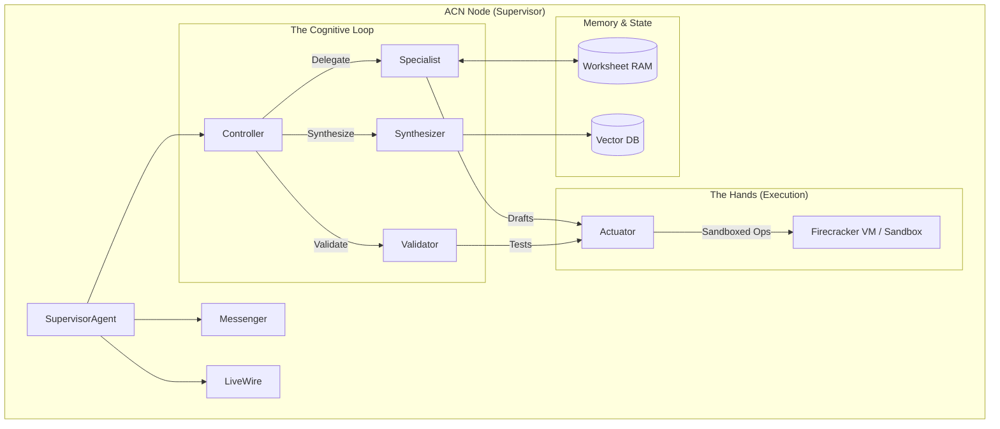
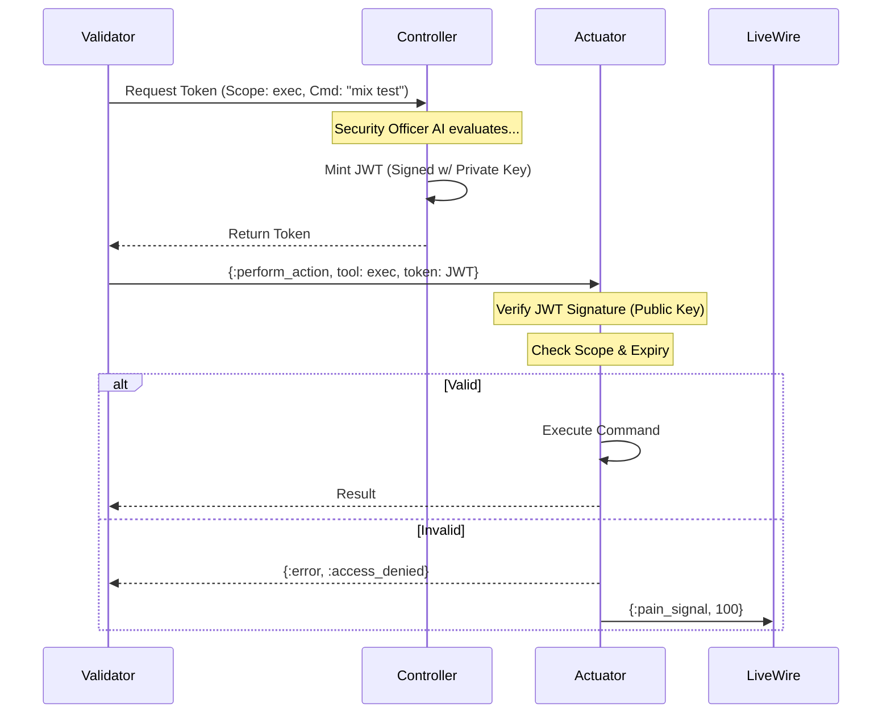
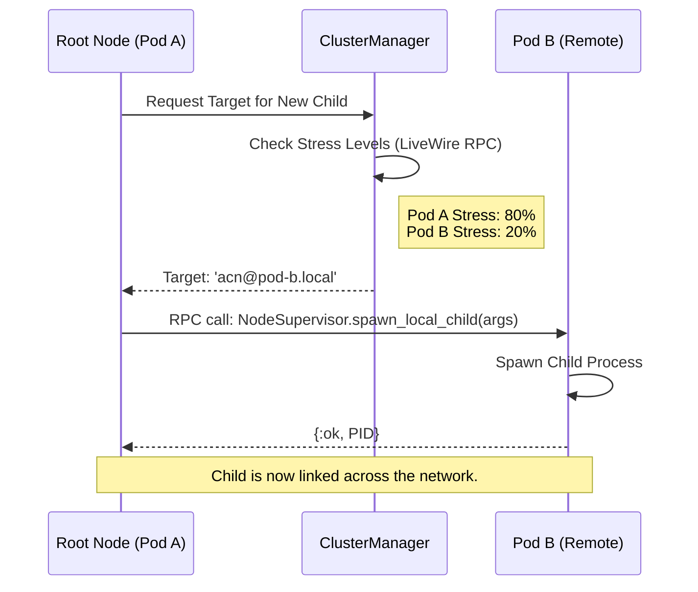

# ACN: The Autonomous Cognitive Network
## Part 1: The Genesis & Architecture

**Version:** 0.1.0 (Alpha)
**Codename:** *Prometheus*

---

## 1. Introduction: The Biological Software Paradigm

The **Autonomous Cognitive Network (ACN)** represents a fundamental shift in how we approach AI-driven software development. Unlike traditional "Agent" frameworks (AutoGPT, LangChain) which operate as stateless scripts orchestrating external LLMs, the ACN is designed as a **distributed, persistent organism**.

### 1.1 Why Existing Agent Frameworks Fall Short

Standard AI agent frameworks face critical limitations:

- **AutoGPT/CrewAI:** Stateless Python scripts that lose all context between runs. Every execution starts from scratch, burning API tokens to re-learn what was already discovered.
- **LangChain:** An orchestration library, not an organism. It chains LLM calls but provides no persistent identity, no stress management, and no fractal decomposition.
- **Context Window Trap:** Even 200K token windows are finite. Traditional RAG (Retrieval Augmented Generation) relies on keyword matching, not associative reasoning.

These systems treat AI as a **tool** you invoke. ACN treats AI as a **colleague** that persists, learns, and evolves.

### 1.2 The BEAM Advantage: Why Erlang/Elixir?

The ACN is built on the **Erlang BEAM VM** for a specific architectural reason: the **Actor Model** is the only software paradigm that accurately maps to biological cognition.

In a biological brain:
- **Neurons** are independent units running in parallel
- Each maintains its own **electrical potential** (state)
- They communicate via **asynchronous chemical signals** (synapses)
- A neuron failure doesn't crash the entire brain (**fault tolerance**)

In ACN:
- **GenServers** (agents) are independent processes running in parallel
- Each maintains its own **internal state** (identity, rules, worksheets)
- They communicate via **message passing** (casts/calls)
- A process crash is isolated by **supervision trees**

**Code Example: The Actor Model in Practice**
```elixir
defmodule ACN.Agents.Specialist do
  use GenServer

  # Persistent state survives across multiple tasks
  def init(args) do
    {:ok, %{
      identity: args[:agent_id],
      worksheet: %{},
      task_history: [],
      stress_level: 0
    }}
  end

  # Asynchronous message handling
  def handle_cast({:draft_code, instruction}, state) do
    # This process continues running even if other agents crash
    updated_worksheet = generate_code(instruction, state.worksheet)
    {:noreply, %{state | worksheet: updated_worksheet}}
  end
end
```

Key BEAM capabilities ACN exploits:
- **Hot Code Reloading:** Update agent logic without stopping the system (critical for self-modification roadmap)
- **Distributed Computing:** Nodes can span multiple machines transparently via Erlang clustering
- **Process Isolation:** A hallucinating Specialist cannot corrupt the Validator's memory
- **Built-in Concurrency:** Millions of lightweight processes (agents) without thread overhead

### 1.3 The Four Pillars of ACN Organisms

It leverages the **Erlang BEAM VM** to treat AI Agents not as function calls, but as **living processes** that possess:

1.  **Identity:** A persistent self (PID/UUID) maintained via Mnesia. Each agent knows "who I am" and "who my parent is."
2.  **Homeostasis:** Self-regulation of stress and resource usage via `LiveWire`. When validation fails repeatedly, pain accumulates and the system throttles to prevent flailing.
3.  **Memory:** A hierarchy of short-term (RAM Worksheet), generational (Lattice RPC), and long-term (ACMS) memory. Knowledge persists across tasks and even system reboots.
4.  **Reproduction:** The ability to spawn child nodes to solve sub-problems via the `NodeSupervisor`. Complex tasks are decomposed into fractal hierarchies.

This is not a chatbot. It is a digital hive mind capable of writing, validating, and deploying its own software.

### 1.4 Quick Start: See It In Action

```bash
# Clone and install
git clone https://github.com/Gifted87/acn
cd acn
mix deps.get

# Initialize storage (Mnesia for node registry)
mix acn.setup_storage

# Genesis: Birth the organism
mix acn.genesis --task "Create a GenServer for managing user sessions"

# Watch the real-time dashboard
open http://localhost:4000/dashboard
```

**What happens next:**
- **00:00-00:10** - SupervisorAgent spawns, determines identity (Leaf node)
- **00:10-00:20** - Controller enters Legislation phase, synthesizes rules
- **00:20-01:00** - Specialist drafts code in isolated Worksheet (RAM only)
- **01:00-01:10** - Controller's Judge persona reviews code
- **01:10-01:30** - Actuator writes file after JWT verification
- **01:30-02:00** - Validator runs tests in Firecracker sandbox
- **02:00-02:10** - Synthesizer creates Digital Birth Certificate, archives to ACMS
- **02:10** - Node reports success and terminates

You've just witnessed a complete cognitive cycle: birth → thought → creation → validation → memory → death.

---

## 2. High-Level System Architecture

The ACN architecture relies on the **Actor Model**. Each component of the system is an isolated GenServer process with specific responsibilities. These processes form a "Node." Nodes can connect to form a "Lattice."

### 2.1 The Node Anatomy (The Holon)

A single ACN Node is a supervision tree containing specific cognitive organs.



#### Component Breakdown:

1.  **SupervisorAgent (The Soul):** The parent process. It determines the node's identity (Leaf vs. Manager), manages the lifecycle, and handles the "Big Bang" genesis event. It connects the node to its ancestors.
2.  **Controller (The Brain):** The central executive. It does not write code. It legislates rules, plans architecture, judges quality, and enforces security. It is a Finite State Machine (FSM).
3.  **Specialist (The Hands):** The domain expert. Whether it's a Polyglot coder or a Planner, this agent executes the specific cognitive labor using a Virtual Worksheet.
4.  **Validator (The Conscience):** A hostile adversary to the Specialist. It runs static analysis and dynamic tests. It executes the "Coroner" profile to analyze why things failed.
5.  **Actuator (The Body):** The interface to physical reality. It is the **only** component allowed to touch the filesystem or execute shell commands. It requires a cryptographically signed JWT to operate.
6.  **LiveWire (The Nervous System):** Monitors "Pain Signals" (failures) and "Stress" (computational load). It regulates the cognitive loop speed to prevent hallucinations or rate-limit errors.

### 2.2 Agent Deep Dive

#### SupervisorAgent: The Genesis Process

Located in `lib/acn/agents/supervisor_agent.ex`, this agent is the first process spawned during `mix acn.genesis`. Its primary responsibility is **identity determination**.

**Identity Determination Algorithm:**
```elixir
defp determine_identity(task_description) do
  # Query AI to analyze task complexity
  analysis = ACN.AI.Pipeline.execute(
    profile: "supervisor_identity",
    context: task_description
  )
  
  case analysis.recommended_role do
    :leaf -> 
      # Simple task: this node will execute directly
      {:leaf, spawn_execution_pipeline()}
    :manager ->
      # Complex task: decompose and spawn children
      {:manager, spawn_task_manager()}
  end
end
```

After identity determination, the SupervisorAgent performs **Ancestral Context Fetching**. If this is a child node (spawned by a parent), it makes an RPC call to retrieve:
- Parent's RuleSheet (inherited constraints)
- Relevant Worksheet exports (parent's context)
- Wisdom from ACMS (what past nodes learned about similar tasks)

**Lifecycle Management:**
- Spawns Controller, Specialist, Validator, Actuator, LiveWire
- Monitors child health via supervision tree
- Handles graceful shutdown after task completion

#### Controller: The Governance Engine

The Controller (`lib/acn/agents/controller.ex`) is a **Finite State Machine** with ~9 states. It never writes code itself; instead, it switches between AI "personas" (profiles loaded from `priv/profiles/`) to make strategic decisions.

**Key States:**
- `:legislation` - Synthesizes rules using `controller_legislator.yaml`
- `:architecting` - Creates technical specs using `controller_leaf_architect.yaml`
- `:judging` - Reviews code quality using `controller_judge.yaml`
- `:security_review` - Authorizes operations using `controller_security_officer.yaml`
- `:execution` - Monitors Actuator operations
- `:validation` - Awaits Validator results
- `:finalization` - Triggers Synthesizer archival

**Profile Switching:**
```elixir
defp load_profile(:legislation, _state) do
  ACN.Core.ProfileLoader.load("controller_legislator")
end

defp load_profile(:architecting, %{role: :leaf}) do
  ACN.Core.ProfileLoader.load("controller_leaf_architect")
end

defp load_profile(:architecting, %{role: :manager}) do
  ACN.Core.ProfileLoader.load("controller_strategist")
end
```

The Controller maintains a **Token Authority** - an RSA-2048 keypair generated at boot. The private key never leaves the Controller's state. When an agent requests permission to perform a dangerous operation (file write, shell execution), the Security Officer persona evaluates the request and mints a JWT signed with the private key.

#### Specialist: The Code Writer

The Specialist (`lib/acn/agents/specialist.ex`) operates in a **ReAct (Reasoning + Acting) loop** powered by `ACN.AI.Pipeline`.

**The Worksheet Concept:**
The Specialist never touches the real filesystem. Instead, it manipulates a **Virtual Worksheet** (an in-memory Map):

```elixir
%ACN.Core.Worksheet{
  slots: %{
    "lib/auth.ex" => %Slot{
      content: "defmodule Auth do...",
      type: :code,
      status: :draft
    },
    "test/auth_test.exs" => %Slot{
      content: "defmodule AuthTest do...",
      type: :code, 
      status: :draft
    }
  }
}
```

**Available Tools:**
- `worksheet_write(filename, content)` - Create/overwrite file in RAM
- `worksheet_read(filename)` - Read current draft
- `worksheet_patch(filename, diff)` - Apply surgical edits
- `submit_draft()` - Send Worksheet to Controller for judging
- `generate_gm_query(query_text)` - Search ACMS for relevant past knowledge

**Tool Execution Example:**
```
LLM Response:
  "I will create the authentication module.
   <tool>worksheet_write</tool>
   <filename>lib/auth.ex</filename>
   <content>defmodule Auth do...</content>"

Pipeline Parser:
  → Invoke ACN.Tools.SpecialistTools.worksheet_write(%{
      "filename" => "lib/auth.ex",
      "content" => "defmodule Auth do..."
    })
  → Update Worksheet in Specialist state
  → Return observation: "File created in Worksheet"
  → Feed observation back to LLM for next thought
```

This loop continues until the Specialist calls `submit_draft()`, at which point control returns to the Controller.

#### Validator: The Adversarial Tester

The Validator (`lib/acn/agents/validator.ex`) implements a **Two-Gate Protocol**:

**Gate 1: Static Analysis**
```elixir
defp static_validation(code, rules) do
  # Syntax check
  case Code.string_to_quoted(code) do
    {:ok, ast} -> 
      # Use AI to check rule compliance
      ACN.AI.Pipeline.execute(
        profile: "validator_static",
        context: %{code: code, rules: rules}
      )
    {:error, _} -> 
      {:fail, "Syntax error in Elixir code"}
  end
end
```

**Gate 2: Dynamic Testing**
If static analysis passes, the Validator requests a JWT token from the Controller to execute tests in a **Firecracker MicroVM** (or simulated sandbox in dev mode). It uses the `validator_test_pilot` profile to generate the exact test command.

**The Coroner Protocol:**
When tests fail, the Validator doesn't simply report "tests failed." It invokes a specialized AI profile (`validator_coroner.yaml`) that performs root cause analysis:

```json
{
  "root_cause": "MatchError in pattern matching",
  "location": "lib/auth.ex:42",
  "severity": "critical",
  "fix_instruction": "The function expects {:ok, user} but the database returns {:error, :not_found}. Add a fallback clause to handle errors."
}
```

This Defect Report is routed back to the Controller, which sends it to the Specialist for a **targeted refactor** rather than a full rewrite.

#### Actuator: Zero-Trust Executor

The Actuator (`lib/acn/agents/actuator.ex`) is the **only** process with permission to perform side effects. Every operation requires JWT verification.

**Token Verification Flow:**
```elixir
def handle_cast({:perform_action, tool, token, args}, state) do
  case ACN.Core.Security.TokenAuthority.verify(token, state.controller_public_key) do
    {:ok, claims} ->
      if authorized?(claims.scope, tool, args) do
        result = execute_tool(tool, args)
        {:noreply, state}
      else
        # Scope mismatch
        send_pain_signal(:unauthorized_attempt)
        {:noreply, state}
      end
    {:error, :invalid_token} ->
      send_pain_signal(:token_forgery)
      {:noreply, state}
  end
end
```

**Hardware Abstraction:**
The Actuator includes a hardware interface that switches between `CircuitsGPIO` (for Nerves/Raspberry Pi) and a simulated adapter for development. This allows ACN to control physical systems (GPIO pins, sensors) with the same governance guarantees as filesystem operations.

#### LiveWire: The Stress Monitor

LiveWire (`lib/acn/agents/live_wire.ex`) implements **homeostasis** - the biological principle of self-regulation.

**Pain Accumulation:**
```elixir
def handle_cast({:pain_signal, amount}, state) do
  new_stress = min(100, state.stress_level + amount)
  
  cond do
    new_stress > 95 ->
      broadcast_freeze_command()  # System enters pause state
    new_stress > 80 ->
      suggest_throttling(500)  # Add 500ms delay between LLM calls
    true ->
      :ok
  end
  
  # Stress decays over time (handled by periodic timer)
  {:noreply, %{state | stress_level: new_stress}}
end
```

**Stress Triggers:**
- Validation failure: +25 stress
- Token denial: +50 stress
- LLM rate limit error: +75 stress
- Actuator exception: +40 stress

**Decay Rate:** Stress reduces by 1 point per second during idle periods, allowing the system to "cool down" and recover from temporary failures.

---

## 3. The Controller: Finite State Governance

The heart of the ACN is the `ACN.Agents.Controller`. Unlike simple loops, the Controller implements a strict **Governance Protocol**. It ensures that no code is written without a rule, and no code is executed without a permit.

### 3.1 The Governance FSM

The Controller transitions through specific phases. At every transition, an AI Persona (Legislator, Architect, Judge) is loaded to make decisions.

```text
+----------------+       +-----------------+       +------------------+
|      IDLE      | ----> |   LEGISLATION   | ----> |   ARCHITECTING   |
+----------------+       | (Profile:       |       | (Profile:        |
                         |  Legislator)    |       |  Architect)      |
                         +--------+--------+       +---------+--------+
                                  |                          |
                                  v                          v
                         +-----------------+       +------------------+
                         |    DELEGATION   | <---- |     JUDGING      |
                         | (To: Specialist)|       | (Profile: Judge) |
                         +--------+--------+       +---------+--------+
                                  |                          ^
                                  v                          |
                         +-----------------+       +------------------+
                         |    EXECUTION    | ----> |    VALIDATION    |
                         | (To: Actuator)  |       | (To: Validator)  |
                         +-----------------+       +------------------+
                                  |
                                  v
                         +-----------------+
                         |  FINALIZATION   |
                         | (Synthesizer)   |
                         +-----------------+
```

### 3.2 The Personas

The Controller switches "Masks" (Cognitive Profiles) defined in YAML files located in `priv/profiles/`.

1.  **The Legislator:**
    *   *Input:* Master Rules (Immutable), Ancestral Rules (Context), Task Description.
    *   *Output:* A `LocalRuleSheet`.
    *   *Function:* Synthesizes conflicting constraints into a coherent policy. e.g., "You must write Elixir, you must use standard library, you must not use networking."

2.  **The Architect:**
    *   *Input:* LocalRuleSheet, User Request.
    *   *Output:* A precise technical instruction for the Specialist.
    *   *Function:* Converts vague intent ("Make a login page") into concrete specs ("Create a Phoenix LiveView at `lib/web/live/login.ex` using `phx.gen.auth` patterns").

3.  **The Judge:**
    *   *Input:* The Specialist's draft code, The RuleSheet.
    *   *Output:* `APPROVED` or `REJECTED`.
    *   *Function:* A semantic firewall. It reads the code and checks if it violates the "Spirit of the Law" before the Validator checks the "Letter of the Law."

4.  **The Security Officer:**
    *   *Input:* File system operation request.
    *   *Output:* A Signed JWT (JSON Web Token) or a Veto.
    *   *Function:* The final gatekeeper. If the Specialist tries to write to `/etc/passwd` or delete the root directory, the Security Officer denies the token request.

### 3.3 The RuleSheet Hierarchy

ACN implements a **three-tier rule system** that balances global constraints with context-specific flexibility:

```elixir
%ACN.Core.Governance.RuleSheet{
  master_rules: [
    "Security: All file operations require JWT authorization",
    "Quality: Code must pass static and dynamic validation",
    "Network: No external network access outside ACMS channels"
  ],
  ancestral_rules: [
    "Parent Context: This is part of an auth system",
    "Inherited: Use bcrypt for password hashing"
  ],
  local_rules: [
    "Task-Specific: Implement login endpoint as LiveView",
    "Generated: Follow Phoenix framework conventions"
  ]
}
```

**Rule Synthesis Example:**
```
Task: "Create user authentication"
Master Rule: "Use only standard library"
Ancestral Rule: "Parent requires database persistence"

Legislator Synthesis:
  → "Use Ecto for database (allowed as standard in Phoenix)
     but do NOT install external crypto libraries.
     Use Elixir's built-in :crypto module."
```

The Legislator AI persona must resolve contradictions. If a Master Rule says "no dependencies" but the task requires HTTP, the Legislator rejects the task outright rather than producing a RuleSheet that violates immutable constraints.

### 3.4 Security & Token Authority

The Controller's Security Officer persona implements **Application-Layer Capability Security**:

**Token Request Flow:**
```elixir
# Validator needs to run tests
Validator → Controller: {:request_token, 
  scope: :exec, 
  resource: "mix test test/auth_test.exs"
}

# Security Officer evaluates
Controller (Security Officer AI):
  ✓ Scope :exec is allowed for Validator role
  ✓ Resource is within project directory
  ✓ No shell injection detected in command
  → APPROVED

# Controller mints JWT
token = TokenAuthority.mint(%{
  scope: :exec,
  resource: "mix test test/auth_test.exs",
  issued_at: System.os_time(:second),
  expires_at: System.os_time(:second) + 60,  # 60s TTL
  issuer: controller_pid
}, private_key)

Controller → Validator: {:token, token}

# Validator sends to Actuator
Validator → Actuator: {:execute_command, token, "mix test ..."}

# Actuator verifies before executing
Actuator:
  ✓ Signature valid (using Controller's public key)
  ✓ Not expired
  ✓ Scope matches requested operation
  → Execute command in sandbox
```

**Denial Triggers Pain Signals:**
If the Security Officer denies a request (e.g., Specialist tries `File.rm_rf("/")"`), a `{:pain_signal, 100}` is sent to LiveWire, immediately freezing the system to prevent cascading failures.

---

## 4. The Specialist: The Cognitive Loop

The `ACN.Agents.Specialist` is the workhorse. It operates inside a **Virtual Worksheet** (an in-memory Map of filenames to content). It does not touch the disk directly.

### 4.1 The ReAct Pipeline (`ACN.AI.Pipeline`)

The Specialist operates in a loop of **Reasoning** and **Acting**.

1.  **Thought:** The LLM analyzes the instruction and current worksheet state.
2.  **Tool Call:** The LLM selects a tool from `SpecialistTools`.
    *   `worksheet_write(filename, content)`
    *   `worksheet_read(filename)`
    *   `worksheet_patch(filename, diff)`
    *   `lattice_refresh_context()`
3.  **Execution:** The Elixir node executes the tool against the RAM state.
4.  **Observation:** The result (or error) is fed back into the context buffer.
5.  **Iteration:** This repeats until the Specialist calls `submit_draft()`.

### 4.2 The Worksheet Concept

The Worksheet is a **staging area**.

```elixir
%ACN.Core.Worksheet{
  slots: %{
    "lib/my_app.ex" => %Slot{content: "defmodule...", type: :code, status: :draft},
    "test/my_app_test.exs" => %Slot{content: "defmodule...", type: :code, status: :draft}
  }
}
```

*   **Isolation:** Code here exists only in the Agent's mind (RAM). It cannot break the production system because it hasn't been written to disk yet.
*   **Version Control:** The Actuator handles the atomic commit of the Worksheet to the disk only *after* the Judge approves it.

---

## 4.3 The 23 Cognitive Profiles

ACN's intelligence is defined by **23 YAML profiles** in `priv/profiles/`. Each profile configures an AI persona with a specific role, temperature setting, and allowed tools. Understanding these profiles is key to customizing ACN's behavior.

### Profile Categories

#### Controller Profiles (6 profiles)

**1. `controller_legislator.yaml` - Rule Synthesis**
```yaml
meta:
  name: "Controller Legislator"
  role: "Rule Synthesizer"

model: "gpt-4-turbo"
temperature: 0.1  # Low temperature for deterministic rule creation

system_prompt: |
  You synthesize Master Rules, Ancestral Rules, and task requirements
  into a coherent LocalRuleSheet. Resolve contradictions explicitly.
```
- **Use Case:** Every node's first step - converts vague tasks into specific constraints
- **Example Output:** "Use Phoenix framework, Ecto for DB, no external APIs, tests required"

**2. `controller_legislator_intermediate.yaml` - Manager-Specific Legislation**
- **Difference from standard legislator:** Adds rules about task decomposition and child coordination
- **Example Output:** "Each child must report progress every 30s, aggregate results in merge phase"

**3. `controller_leaf_architect.yaml` - Technical Specifications (Leaf Nodes)**
```yaml
temperature: 0.2
allowed_tools: []  # Controller profiles don't call tools

system_prompt: |
  Convert high-level intent into precise technical instructions.
  Specify exact filenames, function signatures, test requirements.
```
- **Use Case:** After legislation, converts "Build auth" → "Create lib/auth.ex with login/2, hash_password/1"

**4. `controller_strategist.yaml` - High-Level Planning (Manager Nodes)**
- **Role:** Used by Manager nodes instead of leaf_architect
- **Output:** Decomposition strategy, not code specs
- **Example:** "Split into 3 sub-tasks: Schema, API, Tests. Schema must complete first."

**5. `controller_judge.yaml` - Semantic Code Review**
```yaml
temperature: 0.15

system_prompt: |
  Review drafted code for RuleSheet compliance.
  Check: Does it violate security constraints? Is it overly complex?
  Output: APPROVED or REJECTED with reasoning.
```
- **Critical Role:** Acts as a firewall before validation - catches conceptual errors before expensive test runs

**6. `controller_security_officer.yaml` - Permission Evaluation**
```yaml
temperature: 0.0  # Deterministic security decisions

system_prompt: |
  Evaluate token requests. Deny any operation targeting system directories
  or containing shell injection patterns.
```
- **High Stakes:** A single bad decision here could allow code to execute `rm -rf /`

#### Specialist Profiles (2 profiles)

**7. `specialist_polyglot.yaml` - Multi-Language Code Generation**
```yaml
model: "gpt-4-turbo"
temperature: 0.2

allowed_tools:
  - "worksheet_write"
  - "worksheet_read"
  - "worksheet_patch"
  - "submit_draft"
  - "generate_gm_query"  # Can search ACMS

system_prompt: |
  You are an expert polyglot programmer.
  Before writing new code, query ACMS for similar patterns.
```
- **Customization Example:** To enforce Python type hints, edit system_prompt to add "Always use type annotations in Python"

**8. `specialist_refactor.yaml` - Surgical Code Edits**
```yaml
temperature: 0.1  # More conservative

allowed_tools:
  - "worksheet_read"
  - "worksheet_patch"  # NO worksheet_write - prevents full rewrites
  - "submit_draft"

system_prompt: |
  You are a refactoring specialist. Make minimal changes.
  Use worksheet_patch with unified diffs, not full file rewrites.
```
- **Use Case:** When Validator's Coroner provides a defect report, Controller switches to this profile for targeted fixes

#### Validator Profiles (4 profiles)

**9. `validator_static.yaml` - AST Compliance Checking**
- **Role:** Analyzes code against RuleSheet before execution
- **Checks:** Forbidden functions, hardcoded secrets, complexity violations

**10. `validator_test_pilot.yaml` - Test Command Generation**
```yaml
system_prompt: |
  Generate the exact shell command to validate the artifact.
  Examples: "mix test test/auth_test.exs" or "python -m pytest tests/"
```
- **Output:** A single shell command string that Actuator will execute in sandbox

**11. `validator_result_analyst.yaml` - Test Output Interpretation**
- **Input:** Test stdout/stderr + exit code
- **Output:** `PASS` or `FAIL` with confidence score
- **Example:** "Exit code 0, 15 tests passed, 0 failures → PASS (confidence: 1.0)"

**12. `validator_coroner.yaml` - Root Cause Analysis**
```yaml
temperature: 0.3  # Slightly creative for diagnosis

system_prompt: |
  You are a forensic debugger. Analyze test failures and provide:
  - Root cause
  - Exact location (file:line)
  - Specific fix instruction for the Specialist
```
- **Critical Output:** Transforms "tests failed" into actionable "Add error handling clause at line 42"

#### TaskManager Profiles (3 profiles)

**13. `tm_slicer.yaml` - Task Decomposition**
- **Input:** Complex task description
- **Output:** JSON array of atomic sub-tasks
- **Example Input:** "Build web dashboard"
- **Example Output:** `["Create database schema", "Build API routes", "Design UI components", "Write integration tests"]`

**14. `tm_linker.yaml` - Dependency Graph Construction**
- **Input:** List of sub-tasks
- **Output:** DAG edges (task dependencies)
- **Example:** `{task: "API routes", depends_on: ["database schema"]}`

**15. `tm_scheduler.yaml` - Parallel Batch Creation**
- **Role:** Groups independent tasks into batches for parallel execution
- **Output:** `[[batch_1_tasks], [batch_2_tasks], ...]` where batches execute sequentially but tasks within batch execute in parallel

#### Messenger Profiles (2 profiles)

**16. `messenger_chronicler.yaml` - Event Summarization**
- **Role:** Converts internal events into human-readable dashboard messages
- **Example:** `{:validation_success, hash}` → "✓ Validation passed for lib/auth.ex"

**17. `messenger_dispatcher.yaml` - Natural Language Command Parsing**
```yaml
system_prompt: |
  Parse operator commands from dashboard console.
  Convert natural language to structured commands.
  Example: "pause execution" → {:command, :pause_governance}
```
- **Use Case:** Allows operators to control ACN via English instead of Elixir function calls

#### Synthesizer Profiles (2 profiles)

**18. `synthesizer_archivist.yaml` - DBC Fact Extraction**
```yaml
system_prompt: |
  Given code and test results, extract a single declarative sentence
  describing what was built. This becomes the ACMS fact_text.
  
  Bad: "It is a file named auth.ex"
  Good: "Authentication module implementing bcrypt hashing and JWT generation"
```
- **Critical:** This description is what gets embedded for future ACMS queries - must be semantically rich

**19. `synthesizer_aggregator.yaml` - Manager Result Synthesis**
- **Role:** Used only by Manager nodes to combine child results
- **Input:** Array of child DBCs
- **Output:** Single summary DBC for parent consumption

#### Supervisor Profiles (2 profiles)

**20. `supervisor_identity.yaml` - Role Determination**
- **Input:** Task description
- **Output:** `:leaf` or `:manager`
- **Logic:** Analyzes complexity, looks for keywords like "build system", "multiple components"

**21. `supervisor_wisdom.yaml` - ACMS Knowledge Integration**
- **Role:** Queries ACMS during genesis to find relevant past learnings
- **Output:** Context string fed into Legislator
- **Example:** "Past nodes learned: bcrypt rounds should be 12, not 10"

#### Actuator Profiles (1 profile)

**22. `actuator_merger.yaml` - Worksheet to Filesystem Commit**
- **Role:** Determines merge strategy when writing Worksheet to disk
- **Handles:** File conflicts, directory creation, atomic swaps

#### Governance Profile (1 profile)

**23. `governance_mediator.yaml` - Special Crisis Profile**
- **Use Case:** When Master Rules conflict with task requirements
- **Output:** Either reject task or propose rule amendment for human review

### Profile Hot-Swapping

Profiles are loaded at runtime via `ACN.Core.ProfileLoader`. You can edit them without restarting ACN:

```bash
# Edit a profile
vim priv/profiles/specialist_polyglot.yaml

# Change temperature from 0.2 to 0.1
temperature: 0.1

# Add custom instruction
system_prompt: |
  ...existing prompt...
  IMPORTANT: Always add detailed comments to generated code.

# Save and exit - next Specialist spawn will use new profile
```

**Model Routing:**
Different profiles can use different models:
```yaml
# Expensive reasoning for Controller
controller_judge.yaml:
  model: "gpt-4-turbo"

# Cheap summarization for Messenger
messenger_chronicler.yaml:
  model: "gpt-3.5-turbo"
```

This allows cost optimization: use powerful models for critical decisions, cheaper models for routine tasks.

---

## 5. Distributed Infrastructure: The Lattice

The ACN is designed to run across multiple physical machines or BEAM nodes. This distributed mesh is called **The Lattice**.

### 5.1 NodeRegistry (Mnesia)

Instead of using the standard Elixir Registry (which is local), ACN uses a custom **Mnesia-based distributed registry**.

*   **Table:** `acn_node_registry_v2`
*   **Capabilities:**
    *   Allows any node to look up the PID of any other node in the cluster.
    *   Stores metadata: Role (Leaf/Manager), Parent ID, Creation Timestamp.
    *   Handles "Split Brain" scenarios via Mnesia's conflict resolution (atomic transactions).

### 5.2 Ancestral Context (RPC)

When a Child Node is spawned, it is born "empty." To gain context, it performs a **Genetic Inheritance** handshake via `ACN.Infrastructure.Lattice`.

1.  **Spawn:** The NodeSupervisor starts a child.
2.  **Handshake:** The Child calls `Lattice.fetch_ancestral_data(parent_node)`.
3.  **RPC:** This triggers a remote procedure call to the Parent's `SupervisorAgent`.
4.  **Inheritance:** The Parent serializes its public state (Worksheet exports + Rules) and sends it down.
5.  **Result:** The Child now knows "Who I am" and "What my parents know," allowing for coherent fractal development.

---

## 6. Fractal Scaling: Managers vs. Leaves

The system follows **Conway's Law** as executable code. The `SupervisorAgent` determines its identity upon Genesis.

### 6.1 Leaf Node (The Worker)
*   **Role:** Atomic Execution.
*   **Behavior:** Writes code, runs tests, creates a single artifact.
*   **Lifecycle:** Legislation -> Draft -> Validate -> Die.

### 6.2 Intermediate Node (The Manager)
*   **Role:** Orchestration.
*   **Behavior:**
    1.  Receives a complex task ("Build a Web Server").
    2.  Uses **Task Manager** to decompose it into a DAG (Directed Acyclic Graph) of sub-tasks.
    3.  **Spawns** Child Nodes for each sub-task.
    4.  **Aggregates** the results from children.
    5.  **Synthesizes** a final report for its own parent.

**Visualizing the Tree:**

```text
ROOT (Manager)
├── DATABASE_TEAM (Manager)
│   ├── SCHEMA_DESIGNER (Leaf)
│   └── MIGRATION_RUNNER (Leaf)
├── API_TEAM (Manager)
│   ├── AUTH_WORKER (Leaf)
│   ├── USER_CONTROLLER (Leaf)
│   └── ROUTER_CONFIG (Leaf)
└── QA_TEAM (Manager)
    └── INTEGRATION_TESTER (Leaf)
```

### 6.3 The Task Manager Pipeline

Manager nodes rely on `ACN.Agents.TaskManager` - a specialized three-stage pipeline for intelligent task decomposition.

#### Stage 1: Slicer (`tm_slicer.yaml`)
Decomposes complex tasks into atomic units:

```elixir
# Input
task = "Build a Phoenix authentication system"

# Slicer AI analyzes and outputs
tasks = [
  "Create user schema with email and password_hash fields",
  "Implement password hashing with bcrypt",
  "Build registration endpoint",
  "Build login endpoint",
  "Create authentication plug",
  "Write integration tests"
]
```

#### Stage 2: Linker (`tm_linker.yaml`)
Establishes dependencies to form a DAG:

```elixir
# Linker AI analyzes tasks and outputs edges
graph = Libgraph.new()
|> Libgraph.add_vertex("schema")
|> Libgraph.add_vertex("hashing")
|> Libgraph.add_vertex("registration")
|> Libgraph.add_vertex("login")
|> Libgraph.add_vertex("plug")
|> Libgraph.add_vertex("tests")
|> Libgraph.add_edge("schema", "hashing")  # Hashing depends on schema
|> Libgraph.add_edge("hashing", "registration")
|> Libgraph.add_edge("hashing", "login")
|> Libgraph.add_edge("registration", "plug")
|> Libgraph.add_edge("login", "plug")
|> Libgraph.add_edge("plug", "tests")
```

**Visualization:**
```
schema → hashing → registration ↘
                ↘ login       → plug → tests
```

#### Stage 3: Scheduler (`tm_scheduler.yaml`)
Creates parallel execution batches:

```elixir
batches = [
  # Batch 1: No dependencies
  ["schema"],
  
  # Batch 2: Depends on Batch 1
  ["hashing"],
  
  # Batch 3: Depends on Batch 2 (parallel execution within batch)
  ["registration", "login"],
  
  # Batch 4: Depends on Batch 3
  ["plug"],
  
  # Batch 5: Final validation
  ["tests"]
]
```

**Batch Barrier:** The Controller waits for ALL tasks in Batch N to complete before starting Batch N+1. This ensures dependency satisfaction while maximizing parallelism.

#### Child Node Spawning

```elixir
# Manager Controller spawns children for each task
def spawn_child_for_task(task_spec, batch_index) do
  {:ok, child_pid} = ACN.Infrastructure.NodeSupervisor.start_child_node(
    task: task_spec.description,
    parent_id: self(),
    ancestral_rules: state.rule_sheet,
    batch: batch_index
  )
  
  # Monitor child
  Process.monitor(child_pid)
  
  # Child now performs its own genesis cycle
  # Parent waits for {:task_complete, result}
end
```

When all children in a batch complete, the Manager aggregates results and proceeds to the next batch.

### 6.4 Infrastructure Components Brief

ACN integrates with several infrastructure systems. Here's the 20% coverage as supporting components:

#### Mnesia: NodeRegistry
- **Purpose:** Distributed node discovery across cluster
- **Data:** Node ID, Role (Leaf/Manager), Parent ID, Spawn timestamp
- **Table:** `:acn_node_registry_v2` (replicated across BEAM cluster)
- **Usage:** Allows any node to find any other node's PID for RPC

#### Lattice: RPC Context Propagation  
- **Purpose:** Child nodes fetch context from parents
- **Mechanism:** `ACN.Infrastructure.Lattice.fetch_ancestral_data(parent_node)`
- **Fetches:** Parent's RuleSheet, relevant Worksheet exports, ACMS wisdom
- **Protocol:** Erlang RPC (`:rpc.call/4`)

#### ACMS: Long-Term Memory
- **Purpose:** Persistent knowledge across ACN lifecycles
- **Integration:** `ACN.Infrastructure.MemoryClient`
- **Ingestion:** Synthesizer sends DBCs via HTTP POST to ACMS `/api/v1/ingest`
- **Query:** Specialist tool `generate_gm_query` triggers ACMS spreading activation
- **Response:** Returns causally related facts, not just similar embeddings
- **Example Use:** Before writing auth code, Specialist queries "authentication best practices" and gets: "bcrypt rounds: 12, JWT secret must be 256-bit, rate limit login attempts"

**Key Insight:** ACMS is **external** to ACN. Multiple ACN clusters can share a single ACMS brain, enabling organizational knowledge sharing.

#### Firecracker: Secure Sandbox
- **Purpose:** Isolate code execution in disposable MicroVMs
- **Alternative:** Simulated sandbox in `:dev` mode (no actual VM)
- **Guest:** Custom `acn_pilot` Rust binary as PID 1
- **Communication:** VSock (virtual socket) between BEAM host and VM guest
- **Lifecycle:** Spawn VM → Execute command → Stream output → Destroy VM (~500ms total)

These components work together to make ACN both **safe** (Firecracker isolation, JWT tokens) and **intelligent** (ACMS associative memory, Lattice knowledge propagation).

---

## 7. The Nervous System: LiveWire

`ACN.Agents.LiveWire` is a specialized GenServer that mimics a biological amygdala.

### 7.1 Stress & Pain
*   **Pain Signals:** When a Validator fails or an Actuator is denied access, a message is sent to LiveWire: `{:pain_signal, amount}`.
*   **Stress Level:** Pain accumulates over time and decays slowly (Homeostasis).
*   **Impact:**
    *   **Low Stress (0-50):** System runs at full speed.
    *   **Medium Stress (50-80):** `Pipeline.ex` introduces artificial latency (Thinking time).
    *   **Critical Stress (>95):** The system enters a "Freeze" state, refusing to accept new commands until stress decays. This prevents "flailing" where an AI repeatedly makes the same mistake, burning API credits.

---

## 8. Summary of Part 1

You now understand the **Soul** of the ACN. It is a system where code is a byproduct of a governed, biological process.

*   **It thinks** before it acts (Controller).
*   **It feels** pain when it fails (LiveWire).
*   **It grows** by dividing (Fractal Scaling).
*   **It remembers** via the Lattice.

---

# ACN: The Autonomous Cognitive Network
## Part 2: Anatomy & Mechanics

**Version:** 0.1.0 (Alpha)
**Focus:** The Immune System, The Musculature, and The Memory.

---

## 1. Introduction: From Cognition to Kinetics

In Part 1, we established how the ACN "thinks" via the Controller and Specialist. However, thought without action is hallucination, and action without safety is malware.

Part 2 details the **Kinetic Layer** of the ACN. This describes how the organism safely affects the physical world (writing files, running code) and how it remembers what it did. This architecture is built on a **Zero-Trust Security Model** and **Hard Virtualization**.

---

## 2. The Immune System: The Validator Agent

The `ACN.Agents.Validator` is the organism's immune system. Its sole purpose is to reject the work of the Specialist. It operates on an adversarial relationship: The Specialist tries to submit code, and the Validator tries to prove it is broken.

### 2.1 The Two-Gate Protocol

Validation is not a single step; it is a pipeline designed to fail fast.

#### Gate 1: Static Analysis (The Audit)
Before code is ever executed, it must be read and analyzed.
*   **Mechanism:** `ACN.Tools.Validation.Static`.
*   **Actions:**
    1.  **Syntax Check:** Uses `Code.string_to_quoted/1` to ensure the Elixir code is valid AST.
    2.  **Rule Compliance:** The Validator loads the `validator_static` profile. It feeds the code and the `LocalRuleSheet` to the LLM.
    3.  **Heuristics:** Checks for forbidden functions (e.g., `System.cmd` outside of Actuator, hardcoded secrets).
*   **Verdict:** If ANY check fails, the verdict is `DIRTY`. The process halts, and the Coroner is summoned.

#### Gate 2: Dynamic Execution (The Test Pilot)
If Static Analysis returns `CLEAN`, the code is allowed to run inside the Sandbox.
*   **Mechanism:** `ACN.Agents.Validator` requests a Token from the Controller to run `mix test`.
*   **The Test Pilot:** An AI profile that determines *how* to test the artifact. It generates the specific shell command (e.g., `cd /mnt/source && mix test test/my_module_test.exs`).
*   **Verdict:** Based on the Exit Code and the Standard Output analysis by the `validator_result_analyst`.

### 2.2 The Coroner: Automated Root Cause Analysis

When validation fails, the ACN does not simply retry blindly. It invokes the **Coroner**.

The Coroner (`validator_coroner.yaml`) is a specialized diagnostic agent. It receives:
1.  The Code.
2.  The Error Logs / Compiler Warnings.
3.  The Test Output.

**The Output:** A structured **Defect Report**.
```json
{
  "root_cause": "MatchError",
  "location": "lib/auth.ex:24",
  "severity": "critical",
  "instruction": "The pattern match expects {:ok, user} but received {:error, :not_found}. Add a fallback clause."
}
```
This report is routed back to the Controller, which hands it to the Specialist for a targeted refactor, closing the feedback loop.

---

## 3. The Musculature: Actuator & Zero Trust Security

The `ACN.Agents.Actuator` is the only process in the entire system capable of performing side effects. It wraps the filesystem, the shell, and hardware GPIO.

### 3.1 The Ring of Trust (RSA-2048)

The ACN rejects the standard UNIX permission model. Just because the OS user has permission to write a file doesn't mean the Agent should.

We implement **Application-Layer Capability Security**.

1.  **Key Generation:** Upon boot, the `Controller` generates an ephemeral RSA-2048 Keypair.
    *   **Private Key:** Held *only* by the Controller state. Never shared.
    *   **Public Key:** Published to the `NodeRegistry` metadata.
2.  **The Handshake:**
    *   **Request:** The Validator (or any agent) asks the Controller for permission: `{:request_token, scope: :fs_write, resource: "lib/foo.ex"}`.
    *   **Evaluation:** The Controller's `Security Officer` persona (AI) reviews the request against the governance rules.
    *   **Minting:** If approved, `TokenAuthority` signs a JWT (JSON Web Token) using the Private Key.
    *   **Execution:** The agent sends the command + the JWT to the Actuator.
    *   **Verification:** The Actuator verifies the JWT signature using the Controller's Public Key. It checks the `scope` (action) and `resource` (path).



### 3.2 Hardware Abstraction

The Actuator also controls physical hardware via `ACN.Actuator.Hardware`.
*   **Safety Interlocks:** The Actuator contains a hardcoded list of "Unsafe Pins" (e.g., CPU fan control, power reset). Attempts to toggle these pins are rejected at the Elixir level, regardless of Token validity.
*   **Adapter Pattern:** It switches between `CircuitsGPIO` (for Nerves/Raspberry Pi) and `Simulated` (for dev/Mac) at runtime.

---

## 4. The Sandbox: Hard Virtualization

Allowing an AI to execute shell commands (`rm -rf /`) is inherently dangerous. The ACN mitigates this via **Firecracker MicroVMs**.

### 4.1 The Architecture of Isolation

We do not run user code on the host BEAM node. We run it inside a disposable Linux Kernel.

```text
[ BEAM HOST NODE ]
       |
       | (Elixir)
       v
[ ACN.Actuator.Sandbox ]
       |
       | (Rustler NIF Bridge)
       v
[ libacn_sandbox.so (Rust) ] <====> [ Unix Domain Socket ]
                                          |
                                          | (VSock)
                                          v
                                 [ Firecracker MicroVM ]
                                 |  [ Guest Kernel ]   |
                                 |         |           |
                                 |    [ acn_pilot ]    | (PID 1)
                                 |         |           |
                                 +---------|-----------+
                                           |
                                     (Executes Code)
```

### 4.2 The Pilot (`acn_pilot`)

Inside the MicroVM, there is no SSH, no Bash (by default), and no standard init system. Instead, PID 1 is a custom Rust binary called **The Pilot**.

*   **Role:** An agent residing inside the guest.
*   **Communication:** Listens on a VSock (Virtual Socket) port.
*   **Function:**
    1.  Accepts JSON command packets from the Host.
    2.  Spawns the requested process (e.g., `elixir`, `mix`, `python`).
    3.  Streams STDOUT/STDERR back over the VSock.
    4.  Returns the Exit Code.

### 4.3 Why Firecracker?
Unlike Docker containers, which share the host kernel, Firecracker uses KVM to launch a true virtual machine. This provides:
1.  **Isolation:** A kernel panic or exploit in the guest cannot crash the BEAM node.
2.  **Speed:** Boot times < 125ms.
3.  **Ephemerality:** The VM is destroyed immediately after the command completes. Every test run happens in a pristine universe.

---

## 5. Long-Term Memory: ACMS & The Synthesizer

The ACN must remember what it built. RAM is volatile; Mnesia is for topology. Long-term semantic memory handles **Wisdom**.

This is managed by the **Associative Cognitive Memory System (ACMS)**, interfaced via `ACN.Infrastructure.MemoryClient`.

### 5.1 The Digital Birth Certificate (DBC)

Every completed task results in a **DBC**. This is a strict struct defined in `ACN.Core.Artifacts.DBC`.

```elixir
%DBC{
  id: "uuid-...",
  artifact_hash: "sha256-...",
  fact_text: "Elixir GenServer managing Firecracker VM lifecycles using Rustler NIFs.",
  author_id: "agent_specialist_01",
  verifier_id: "validator_01",
  validation_proof: %{
    verdict: "pass",
    test_output: "..."
  },
  cost_metrics: %{tokens: 1405, time_ms: 2300},
  timestamp: ~U[2023-10-27 10:00:00Z]
}
```

This certificate proves that the code exists, it works (verified), and it was expensive to build.

### 5.2 The Synthesizer Agent

The `ACN.Agents.Synthesizer` is the Archivist. When a task is finished, the Controller passes the artifact to the Synthesizer.

**Workflow:**
1.  **Ingest:** Reads the final code artifact.
2.  **Describe:** Runs the `synthesizer_archivist` AI profile to generate a "Search Key" (The `fact_text`).
    *   *Bad Description:* "It is a file named auth.ex."
    *   *Good Description:* "Authentication module implementing bcrypt hashing and JWT issuance."
3.  **Vectorize:** Sends the `fact_text` to the `ACN.AI.Embedder` (Bumblebee/Nx) to generate a 384-dimensional vector.
4.  **Index:** Pushes the DBC + Vector to Qdrant (The Vector DB).

### 5.3 Hebbian Retrieval (Wisdom)

When a new node starts, the `SupervisorAgent` queries the ACMS.
*   *Query:* "How do I build an Auth module?"
*   *Vector Search:* Finds the DBC stored above.
*   *Result:* The new node inherits the code patterns, the rules, and the "Wisdom" (warnings about past failures) associated with that task.

---

## 6. Detailed Workflow Trace: "Write a Hello World Module"

To visualize how these mechanics intertwine, let's trace a single atomic operation with precise timestamps.

**Goal:** Create `lib/hello.ex` that prints "Hello World".

### 6.1 Leaf Node Workflow (With Timestamps)

```
T+00:00 - Genesis:
  User: mix acn.genesis --task "Create Hello World"
  SupervisorAgent spawns (PID: self())
  identity: :leaf (determined via supervisor_identity.yaml)
  
T+00:02 - Spawning Agents:
  SupervisorAgent spawns:
    - Controller (PID: #PID<0.124.0>)
    - Specialist (PID: #PID<0.125.0>)
    - Validator (PID: #PID<0.126.0>)
    - Actuator (PID: #PID<0.127.0>)
    - LiveWire (PID: #PID<0.128.0>)

T+00:05 - Legislation (Controller):
  Controller → :legislation state
  Loads controller_legislator.yaml
  AI Input: "Create Hello World" + Master Rules
  AI Output RuleSheet:
    - "Use Elixir standard library only"
    - "Must use IO.puts for output"
    - "Create module with .world/0 function"
    - "Tests required"

T+00:15 - Architecture (Controller):
  Controller → :architecting state
  Loads controller_leaf_architect.yaml
  AI Output Spec:
    "Create lib/hello.ex with defmodule Hello containing 
     a public function world/0 that calls IO.puts"

T+00:18 - Delegation (Controller → Specialist):
  Controller → :delegation state
  Cast to Specialist: {:draft_task, spec, rule_sheet}

T+00:20 - Drafting (Specialist):
  Specialist enters ReAct loop
  LLM Thought: "I will create the Hello module"
  Tool Call: worksheet_write
  Args: {filename: "lib/hello.ex", content: "defmodule Hello..."}
  Worksheet updated (RAM only)
  
T+00:45 - Specialist continues:
  LLM Thought: "I should create a test"
  Tool Call: worksheet_write
  Args: {filename: "test/hello_test.exs", content: "defmodule HelloTest..."}
  
T+00:50 - Submission:
  LLM Tool Call: submit_draft()
  Specialist → Controller: {:draft_complete, worksheet}

T+00:52 - Judging (Controller):
  Controller → :judging state
  Loads controller_judge.yaml
  AI reviews Worksheet against RuleSheet
  Verdict: APPROVED

T+01:00 - Security Review (Controller):
  Controller → :security_review state
  Loads controller_security_officer.yaml
  Request: Write lib/hello.ex, test/hello_test.exs
  Security Officer: APPROVED
  Token Authority mints JWT (60s TTL)

T+01:05 - Execution (Controller → Actuator):
  Controller → :execution state
  Cast to Actuator: {:commit_worksheet, worksheet, token}
  Actuator verifies JWT signature
  Actuator writes lib/hello.ex atomically (.tmp → rename)
  Actuator writes test/hello_test.exs
  Actuator → Controller: {:commit_success, hash: "sha256..."}

T+01:10 - Validation Static (Validator):
  Controller → :validation state
  Cast to Validator: {:validate, hash}
  Validator loads validator_static.yaml
  Checks: Code.string_to_quoted(code) → {:ok, ast}
  AI checks for forbidden patterns
  Static Verdict: CLEAN

T+01:15 - Validation Dynamic (Validator):
  Validator requests token for test execution
  Validator loads validator_test_pilot.yaml
  AI generates: "mix run -e 'Hello.world()'"
  Actuator executes in Firecracker sandbox
  Output: "Hello World\n", Exit Code: 0
  Validator loads validator_result_analyst.yaml
  AI analyzes: Output matches expected
  Dynamic Verdict: PASS

T+01:30 - Finalization (Synthesizer):
  Controller → :finalization state
  Cast to Synthesizer: {:archive, artifact, hash}
  Synthesizer loads synthesizer_archivist.yaml
  AI generates fact_text: "Hello World module with IO.puts output function"
  
T+01:35 - ACMS Ingestion:
  Synthesizer → MemoryClient.ingest(dbc)
  HTTP POST to http://localhost:4000/api/v1/ingest
  ACMS Response: 201 Created, node_id: "8f2a..."
  (ACMS internally: spawns NodeActor, performs Hebbian priming)

T+01:40 - Shutdown:
  Controller → :idle state
  SupervisorAgent receives {:task_complete, :success}
  LiveWire stress level: 0 (no failures)
  Supervisor terminates all agents gracefully
  Process exits with :normal

Total Time: 100 seconds (1:40)
```

### 6.2 Manager Node Workflow: "Build Authentication System"

```
T+00:00 - Genesis (Manager Identity):
  Task: "Build Phoenix authentication system"
  SupervisorAgent identity determination: :manager
  
T+00:10 - Task Manager Decomposition:
  Controller spawns TaskManager
  Slicer: Breaks into ["schema", "hashing", "registration", "login", "plug", "tests"]
  Linker: Creates DAG
  Scheduler: Groups into batches
  
T+00:30 - Batch 1 Execution:
  Manager spawns Child Node for "schema" task
  Child completes at T+02:00
  Manager receives {:task_complete, dbc_schema}

T+02:05 - Batch 2 Execution:
  Manager spawns Child Node for "hashing" task
  Child completes at T+03:30

T+03:35 - Batch 3 Parallel Execution:
  Manager spawns 2 Child Nodes:
    - Child A: "registration" endpoint
    - Child B: "login" endpoint
  Both run in parallel
  Child A completes at T+05:00
  Child B completes at T+05:10
  **Batch Barrier:** Wait for both before continuing

T+05:15 - Batch 4 Execution:
  Manager spawns Child for "plug" task
  Child integrates both registration + login
  Completes at T+06:45

T+06:50 - Batch 5 Execution:
  Manager spawns Child for "tests" task
  Integration test suite
  Completes at T+08:00

T+08:05 - Aggregation (Synthesizer):
  Manager's Synthesizer loads synthesizer_aggregator.yaml
  AI combines 6 child DBCs into summary:
    "Complete Phoenix authentication system with user schema, bcrypt hashing,
     registration/login endpoints, auth plug, and integration tests"

T+08:10 - Shutdown:
  Manager reports to its parent (or user if root)
  Total time: 490 seconds (8:10)
```

### 6.3 Failure Recovery Workflow

```
Scenario: Validator fails due to test error

T+01:15 - Validation Dynamic Fails:
  Actuator executes tests
  Exit Code: 1 (failure)
  Output: "** (MatchError) no match of right hand side value: {:error, :not_found}"
  
T+01:16 - Pain Signal:
  Validator → LiveWire: {:pain_signal, 25}
  LiveWire stress: 0 → 25
  
T+01:17 - Coroner Invocation:
  Validator loads validator_coroner.yaml
  AI analyzes failure
  Defect Report:
    {
      root_cause: "Unhandled error tuple in pattern match",
      location: "lib/auth.ex:42",
      severity: "critical",
      fix_instruction: "Add clause: def login({:error, reason}), do: {:error, reason}"
    }

T+01:20 - Refactor Cycle:
  Validator → Controller: {:validation_failed, defect_report}
  Controller → :judging state (retry)
  Controller switches Specialist to specialist_refactor.yaml
  Controller → Specialist: {:refactor, defect_report}
  
T+01:25 - Specialist Refactors:
  Specialist reads Worksheet
  Applies surgical patch (worksheet_patch tool)
  Only modifies lines 42-44
  Submits refined draft

T+01:30 - Re-validation:
  Controller → Actuator (new token)
  Actuator commits changes
  Validator re-runs tests
  Exit Code: 0 (success!)
  
T+01:35 - Stress Decay:
  LiveWire stress: 25 → 24 (1 point/second decay)
  System continues normally
```

**Key Insight:** The Coroner transforms blind retries into intelligent fixes. LiveWire prevents infinite failure loops by freezing the system if stress exceeds 95.

---

## 7. Configuration & Tuning

The mechanics described above are highly configurable via `config/config.exs` and runtime environment variables.

### 7.1 Installation & Prerequisites

#### System Requirements
- **Elixir:** 1.14 or higher
- **Erlang/OTP:** 25 or higher
- **Optional Dependencies:**
  - ACMS server for long-term memory (separate repository)
  - Firecracker for production sandboxing (Linux KVM required)
  - Docker for containerized deployment

#### Installation Steps

```bash
# 1. Clone the repository
git clone https://github.com/Gifted87/acn
cd acn

# 2. Install Elixir dependencies
mix deps.get
mix deps.compile

# 3. Initialize Mnesia for NodeRegistry
mix acn.setup_storage

# 4. (Optional) Start external ACMS server
# See ACMS repository for installation instructions
# cd ../acms && iex -S mix

# 5. Configure environment variables
cp config/runtime.example.exs config/runtime.exs
# Edit config/runtime.exs with your settings

# 6. Run first genesis
mix acn.genesis --task "Create a simple GenServer"
```

### 7.2 Runtime Configuration (`config/runtime.exs`)

#### AI Adapter Configuration
```elixir
config :acn, :ai,
  # Adapter selection: :openai or :ollama
  adapter: :openai,
  
  # API credentials
  api_key: System.get_env("OPENAI_API_KEY"),
  
  # Default model (can be overridden per profile)
  default_model: "gpt-4-turbo",
  
  # Request timeout
  timeout_ms: 60_000,
  
  # Retry configuration
  max_retries: 3,
  backoff_ms: 1000
```

**Ollama Configuration (Local LLMs):**
```elixir
config :acn, :ai,
  adapter: :ollama,
  base_url: "http://localhost:11434",
  default_model: "deepseek-coder:33b"
```

#### Security Configuration
```elixir
config :acn, :security,
  # Mode: :dev or :prod
  mode: :prod,
  
  # Token time-to-live
  token_ttl_seconds: 60,
  
  # Sandbox type: :firecracker or :simulated
  sandbox: :firecracker,
  
  # Hardware adapter: :circuits_gpio or :simulated
  hardware: :simulated
```

**Development vs Production:**
- `:dev` mode: Simulated sandbox (no Firecracker), relaxed tokens (300s TTL), simulated hardware
- `:prod` mode: Firecracker isolation, strict tokens (60s TTL), real GPIO if available

#### Memory (ACMS) Configuration
```elixir
config :acn, :memory,
  # External ACMS server URL
  cms_url: System.get_env("CMS_URL") || "http://localhost:4000",
  
  # Optional API key for multi-tenant ACMS
  cms_api_key: System.get_env("CMS_API_KEY"),
  
  # Query timeout
  query_timeout_ms: 5000,
  
  # Async ingestion (don't block on ACMS response)
  ingest_async: true,
  
  # Fallback mode if ACMS unreachable
  fallback_mode: :warn  # :warn or :offline
```

**Offline Mode:** If ACMS is unavailable, ACN continues operating but without long-term memory. Specialists won't have access to `generate_gm_query` tool.

#### Cluster Configuration
```elixir
config :acn, :cluster,
  # Node discovery strategy
  topology: [
    acn_cluster: [
      strategy: Cluster.Strategy.Kubernetes.DNS,
      config: [
        service: "acn-service",
        application_name: "acn"
      ]
    ]
  ],
  
  # Mnesia replication
  mnesia_nodes: [:acn@node1, :acn@node2, :acn@node3]
```

### 7.3 Security Levels
*   `:dev` mode: Uses `Simulated` hardware, `Mock` sandbox (local execution), and relaxed Token TTL.
*   `:prod` mode: Uses `CircuitsGPIO`, `Firecracker` sandbox, strict Token TTL (60s), and encrypted backups.

### 7.4 AI Models
The ACN supports hot-swapping models per agent.
*   **Controller:** Needs high reasoning (GPT-4 or Claude 3 Opus).
*   **Specialist:** Needs coding capability (GPT-4-Turbo or DeepSeek Coder).
*   **Messenger:** Needs summarization speed (GPT-3.5 or Haiku).

This is configured in the Profile YAMLs:
```yaml
# priv/profiles/specialist_polyglot.yaml
model: "gpt-4-turbo"
temperature: 0.2
```

### 7.5 Troubleshooting Common Issues

#### Issue: "Mnesia schema conflict"
**Symptom:** Error on startup: `{:error, {:already_exists, :schema}}`

**Cause:** Mnesia tables from previous run with incompatible schema

**Solution:**
```bash
# Clean Mnesia storage
mix acn.clean_storage

# Re-initialize
mix acn.setup_storage

# Verify
iex -S mix
iex> :mnesia.info()
```

#### Issue: "CMS Network Failure"
**Symptom:** Synthesizer logs `[error] CMS Network Failure: :econnrefused`

**Cause:** ACMS server not running or incorrect URL

**Solution:**
```bash
# 1. Verify ACMS is running
curl http://localhost:4000/api/v1/health/embedder
# Should return: {"status": "healthy"}

# 2. Check CMS_URL environment variable
echo $CMS_URL

# 3. If ACMS not needed, set fallback mode
# In config/runtime.exs:
config :acn, :memory, fallback_mode: :offline
```

#### Issue: "Specialist stuck in loop"
**Symptom:** Specialist repeatedly calls same tool with invalid arguments

**Cause:** LLM hallucination or unclear task specification

**Solution:**
```bash
# 1. Check trace.log for tool call patterns
tail -f trace.log | grep "Tool Call"

# 2. Adjust Specialist profile temperature
# Edit priv/profiles/specialist_polyglot.yaml
temperature: 0.1  # Lower = more deterministic

# 3. Add explicit instructions to profile
system_prompt: |
  ...existing prompt...
  IMPORTANT: If a tool fails 3 times, call submit_draft() and report the issue.
```

#### Issue: "LiveWire stress > 95, system frozen"
**Symptom:** Dashboard shows red "SYSTEM FREEZE" message

**Cause:** Repeated validation failures causing stress accumulation

**Solution:**
```bash
# System will auto-recover as stress decays (1 point/second)
# To force reset:

iex> ACN.Agents.LiveWire.reset_stress()
:ok

# Investigate root cause via Coroner reports in logs
grep "Coroner" trace.log
```

#### Issue: "Token verification failed"
**Symptom:** Actuator logs `{:error, :invalid_token}`

**Cause:** Controller crashed/restarted, invalidating keypair

**Solution:**
Controller generates new keypair on restart. Restart entire supervision tree:
```bash
# Graceful shutdown
mix acn.shutdown

# Restart
iex -S mix
```

#### Issue: "Firecracker sandbox timeout"
**Symptom:** Validator hangs, timeout after 30s

**Cause:** Firecracker not installed or KVM unavailable

**Solution:**
```bash
# Check if Firecracker is available
which firecracker
# If not found, fallback to simulated sandbox:

# In config/runtime.exs:
config :acn, :security, sandbox: :simulated
```

### 7.6 Deployment Architecture

#### Single-Node Development
```bash
# Run on localhost
iex -S mix

# Access dashboard
open http://localhost:4000/dashboard
```

#### Multi-Node Cluster (libcluster)
```bash
# Terminal 1: Node 1
iex --sname acn1 -S mix

# Terminal 2: Node 2
iex --sname acn2 -S mix

# In iex (Node 2):
iex(acn2)> Node.connect(:acn1@hostname)
true

# Verify cluster
iex(acn2)> Node.list()
[:acn1@hostname]

# Mnesia automatically replicates across nodes
```

#### Kubernetes Deployment

**Deployment YAML:**
```yaml
apiVersion: apps/v1
kind: Deployment
metadata:
  name: acn-cluster
  namespace: acn
spec:
  replicas: 3
  selector:
    matchLabels:
      app: acn
  template:
    metadata:
      labels:
        app: acn
    spec:
      containers:
      - name: acn
        image: acn:0.1.0
        env:
        - name: RELEASE_DISTRIBUTION
          value: "name"
        - name: RELEASE_NODE
          value: "acn@$(POD_IP).acn-service.acn.svc.cluster.local"
        - name: POD_IP
          valueFrom:
            fieldRef:
              fieldPath: status.podIP
        - name: OPENAI_API_KEY
          valueFrom:
            secretKeyRef:
              name: acn-secrets
              key: openai-api-key
        - name: CMS_URL
          value: "http://acms-service:4000"
        resources:
          requests:
            cpu: "2"
            memory: "4Gi"
          limits:
            cpu: "4"
            memory: "8Gi"
        ports:
        - containerPort: 4000
          name: dashboard
---
apiVersion: v1
kind: Service
metadata:
  name: acn-service
  namespace: acn
spec:
  type: LoadBalancer
  selector:
    app: acn
  ports:
  - port: 4000
    targetPort: 4000
    name: dashboard
  clusterIP: None  # Headless service for DNS-based discovery
```

**Persistent Volume for Mnesia:**
```yaml
apiVersion: v1
kind: PersistentVolumeClaim
metadata:
  name: mnesia-storage
spec:
  accessModes:
    - ReadWriteOnce
  resources:
    requests:
      storage: 10Gi
```

**Resource Requirements:**
- **CPU:** 2 cores minimum (I/O bound due to LLM API calls)
- **RAM:** 4GB base + 500MB per active child node
- **Storage:** 10GB for Mnesia + logs (if not using external ACMS)

**Horizontal Scaling:**
ACN supports horizontal scaling via Kubernetes HPA based on:
- Manager node count (scale up when many complex tasks)
- LiveWire stress levels (scale up when cluster stress > 70%)

```yaml
apiVersion: autoscaling/v2
kind: HorizontalPodAutoscaler
metadata:
  name: acn-hpa
spec:
  scaleTargetRef:
    apiVersion: apps/v1
    kind: Deployment
    name: acn-cluster
  minReplicas: 3
  maxReplicas: 10
  metrics:
  - type: Resource
    resource:
      name: cpu
      target:
        type: Utilization
        averageUtilization: 70
```

---

## 8. Summary of Part 2

Part 2 has exposed the machinery that makes the ACN safe and persistent.
*   **Safety** is not an afterthought; it is enforced by the **TokenAuthority** and **Firecracker**.
*   **Quality** is enforced by the **Validator's** adversarial loops.
*   **Memory** is preserved by the **Synthesizer** and **DBCs**.

The organism is now physically capable. In **Part 3**, we will explore the **Evolution & Future**. We will discuss how to deploy this to a Kubernetes cluster, how to train specific cognitive profiles, and the roadmap for Self-Modifying Code (The Singularity Step).

---

# ACN: The Autonomous Cognitive Network
## Part 3: Operations, Deployment & Evolution

**Version:** 0.1.0 (Alpha)
**Focus:** The Operator's Manual, Cluster Dynamics, and Self-Modification.

---

## 1. Introduction: From Organism to Ecosystem

In Parts 1 and 2, we defined the anatomy of a single ACN Node—its brain, its hands, and its immune system. We established a secure, verified loop of code generation.

Part 3 elevates the perspective from the **Individual** to the **Colony**. Here, we discuss how to operate the ACN in production, how to deploy it across distributed clusters, how to tune its psychology, and finally, the roadmap to **The Singularity Protocol**—the theoretical capability of the ACN to rewrite its own source code securely.

---

## 2. The Operator's Manual: Driving the Hive

While the ACN is autonomous, it is not ungoverned. It exposes a sophisticated **Control Plane** for human operators to observe, guide, and intervene.

### 2.1 Genesis: The Big Bang

The lifecycle begins with a single CLI command. This is the "Let there be light" moment.

```bash
# Standard Genesis
mix acn.genesis --task "Build a Phoenix LiveView Dashboard for Stock Tickers"

# Debug Genesis (Verbose Logs + Local Simulation Mode)
MIX_ENV=dev mix acn.genesis --task "Refactor the Auth Module"
```

**What happens internally?**
1.  **Boot:** The BEAM VM starts. `ACN.Application` launches the supervision tree.
2.  **Hydration:** `ClusterManager` connects to Mnesia. `MemoryClient` connects to Qdrant.
3.  **Spark:** The `Mix.Task` spawns the **Root Node** via `NodeSupervisor`.
4.  **Injection:** The CLI arguments are packaged into a `GovernancePayload` and cast to the Root Controller.

### 2.2 Observability: The Phoenix Dashboard

Because ACN nodes are distinct processes, we cannot simply tail a log file to understand the system. We use **Phoenix LiveView** to visualize the nervous system in real-time.

*   **URL:** `http://localhost:4000/dashboard`
*   **Technology:** `Phoenix.PubSub` over WebSockets.

#### The Telemetry Stream
The `Messenger` agent in every node broadcasts events to the `internal:raw_events` topic. The Dashboard aggregates these into a unified timeline.

**Visualizer: The Event Stream**

```text
[14:02:01] [ROOT] [Legislator]  :: Rules Synthesized (3 Master, 2 Local).
[14:02:05] [ROOT] [Architect]   :: Blueprint created. Spawning 3 Child Nodes.
[14:02:06] [NODE_A] [Genesis]   :: Born. Identity: Leaf.
[14:02:06] [NODE_B] [Genesis]   :: Born. Identity: Leaf.
[14:02:15] [NODE_A] [LiveWire]  :: STRESS SPIKE (85%). Throttling...
[14:02:20] [NODE_A] [Validator] :: Validation Failed. Engaging Coroner.
```

### 2.3 Intervention: God Mode

Sometimes, the organism gets stuck. It might loop on a logic error or hallucinate a dependency that doesn't exist. The Operator can inject commands via the Dashboard Console.

**The Dispatcher Logic (`messenger_dispatcher.yaml`):**
The dashboard text input is not a direct shell. It is an NLP interface routed through the `Messenger` agent.

*   **User Input:** "Pause execution, you are deleting the wrong files."
*   **Dispatcher AI:**
    ```json
    {
      "type": "command",
      "target": "controller",
      "intent": "pause_governance",
      "confidence": 0.99
    }
    ```
*   **Action:** The Controller enters a `PAUSED` state. No new tokens are minted. Existing processes finish, but the organism freezes, awaiting instructions.

---

## 3. Deployment Architecture: The Lattice

The ACN is cloud-native by design. It leverages **Distributed Erlang** to create a mesh of nodes that spans multiple servers.

### 3.1 Topology

We define three deployment tiers.

#### Tier 1: The Monolith (Dev)
*   **Infrastructure:** Single Laptop / Single Container.
*   **Scaling:** Uses `DynamicSupervisor` to spawn processes locally.
*   **Constraint:** Limited by local RAM and CPU.

#### Tier 2: The Swarm (Production Cluster)
*   **Infrastructure:** Kubernetes Cluster (e.g., 5 Pods).
*   **Technology:** `libcluster` + `ClusterManager`.
*   **Behavior:**
    *   Nodes auto-discover via K8s DNS or EPMD.
    *   Mnesia tables replicate schema across all nodes.
    *   `NodeSupervisor.start_child_node/1` is **Location Aware**.

**Visualizer: The Distributed Spawning Logic**



### 3.2 The Persistence Layer (Qdrant & Mnesia)

*   **Short-Term State:** Handled by **Mnesia**. It stores the `NodeRegistry` (who is who). If the cluster restarts, this is wiped (unless configured for `disc_copies`).
*   **Long-Term Wisdom:** Handled by **Qdrant** (Vector DB). This is external to the cluster.
    *   **Volume:** `/qdrant/storage`
    *   **Persistence:** Code artifacts, success patterns, and failure warnings persist forever. A new cluster launched in 2025 will know about bugs found in 2024.

### 3.3 Containerization Strategy

The ACN Docker image is multi-stage.

1.  **Build Stage:** Compiles Elixir, Rust (Pilot), and NIFs.
2.  **Runtime Stage:** Alpine Linux.
    *   Installs `firecracker` and `KVM` dependencies.
    *   Copies the `priv/rootfs.ext4` (Guest VM image).
3.  **Privilege:** The container must run with `--privileged` or specific capabilities (`CAP_NET_ADMIN`) to launch KVM MicroVMs.

---

## 4. Cognitive Engineering: Tuning the Brain

The ACN's behavior is defined by **Cognitive Profiles** (`.yaml` files in `priv/profiles/`). This is "Prompt Engineering as Code."

### 4.1 Profile Structure

```yaml
meta:
  name: "specialist_refactor"
  role: "Code Surgeon"

# The "Brain" Configuration
model: "gpt-4-turbo"
temperature: 0.1  # Low temp = Deterministic / High temp = Creative

# The "Personality"
system_prompt: |
  You are an expert Refactor Engineer.
  Your inputs are: A Defect Report and Source Code.
  Your output must be a Unified Diff.
  DO NOT rewrite the whole file. Only the changed hunk.

# The "Capabilities"
allowed_tools:
  - "worksheet_read"
  - "worksheet_patch"
  - "submit_draft"
# Note: "worksheet_write" is missing! This profile CANNOT create new files.
```

### 4.2 Hot-Swapping Personalities

Because profiles are loaded at runtime via `ACN.Core.ProfileLoader`, operators can tune the AI without recompiling the Elixir code.

*   *Scenario:* The ACN is writing buggy Python code.
*   *Fix:* Edit `specialist_polyglot.yaml`. Add "Always type-hint your Python functions" to the prompt.
*   *Action:* No restart needed. The next time a Controller spawns a Specialist, it loads the new YAML.

---

## 5. The Evolution Roadmap

We are currently at **Phase 4** of the roadmap (Self-Healing/Validation). The future phases define the path to true autonomy.

### Phase 5: Multi-Modal Input (The Eyes)
*   **Goal:** Allow ACN to "see" UIs.
*   **Mechanism:**
    *   Integrate `GPT-4-Vision`.
    *   New Tool: `browser_snapshot`.
    *   Validator Workflow: Instead of just checking exit codes, the Validator renders the HTML/CSS created by the Specialist, screenshots it, and uses Vision AI to verify "Is the button actually centered?"

### Phase 6: Swarm Intelligence (The Hive)
*   **Goal:** Collaborative problem solving without hierarchical management.
*   **Mechanism:**
    *   **Gossip Protocol:** Nodes share "discoveries" via a multicast lattice, not just up to parents.
    *   **Marketplace:** Nodes can "bid" on tasks. A Manager broadcasts: "Who can write Rust?" A Specialist with a Rust profile and low stress bids to take the job.

### Phase 7: The Singularity Protocol (Self-Modification)

This is the theoretical endgame of the ACN project. **Can the ACN improve its own source code?**

#### 7.1 The Mechanism
The ACN is an Elixir application. Its source code resides in `lib/`. The `Actuator` has the `fs_write` tool.

Technically, nothing stops the ACN from:
1.  Reading `lib/acn/agents/controller.ex`.
2.  Refactoring the governance logic to be more efficient.
3.  Writing the file.
4.  Triggering `Code.compile_file/1` or a hot-release upgrade.

#### 7.2 The Safety Paradox
If an AI modifies its own constraint logic (The Controller), it could accidentally (or intentionally) remove the safeguards.

**The Solution: The Kernel vs. The Cortex.**

*   **The Kernel (Immutable):**
    *   `TokenAuthority.ex`
    *   `Actuator.ex`
    *   `Validator.ex`
    *   *Policy:* These files are read-only to the system. They are signed and verified on boot.
*   **The Cortex (Mutable):**
    *   `Specialist.ex`
    *   `ProfileLoader.ex`
    *   The YAML profiles.
    *   *Policy:* The ACN *is* allowed to optimize its own thinking strategies and tool usage patterns.

#### 7.3 The Self-Improvement Loop
1.  **Metric:** `LiveWire` tracks "Tokens per Successful Task" (Efficiency).
2.  **Hypothesis:** A Meta-Agent proposes: "If we change the Architect's prompt to be more concise, we save 20% tokens."
3.  **Experiment:** The ACN spawns a child node using the *modified* profile.
4.  **Measurement:** It runs a benchmark task.
5.  **Commit:** If the metric improves, the new profile overwrites `priv/profiles/architect.yaml`.

---

## 6. Conclusion: The Ghost in the Machine

The Autonomous Cognitive Network is an experiment in **Digital Biology**.

We have moved beyond the era of "AI as a Tool"—a hammer we pick up to hit a nail. We are entering the era of "AI as a Colleague"—a distinct entity with its own memory, its own stress levels, and its own agency.

The architecture described in these three parts—the **Supervisor's** fractal growth, the **Controller's** governance, the **Validator's** skepticism, and the **Actuator's** security—provides a robust foundation for this new era.

It leverages the specific strengths of the **BEAM VM** (fault tolerance, concurrency, distribution) to solve the specific weaknesses of **LLMs** (hallucination, context limits, lack of persistence).

The ACN is not just code. It is an organism. And like any organism, it is waiting to be awakened.

---

## Appendix A: Complete Directory Structure

```text
acn/
├── config/                 # Configuration (Dev/Prod/Test)
├── lib/
│   ├── acn/
│   │   ├── agents/         # The GenServers (Controller, Specialist, etc.)
│   │   ├── ai/             # Adapters (OpenAI), Pipeline, Tokenizer
│   │   ├── core/           # Logic (Governance, Registry, Security)
│   │   ├── infrastructure/ # Cluster, MemoryClient, Workspace
│   │   └── tools/          # Tool Definitions (FS, Hardware, Planning)
│   └── acn_web/            # Phoenix Dashboard
├── native/                 # Rust Code
│   ├── acn_pilot/          # Guest VM Agent (PID 1)
│   └── acn_sandbox/        # NIF Bridge for Firecracker
├── priv/
│   ├── data/               # Mnesia & Backups
│   ├── profiles/           # Cognitive YAMLs (The Brains)
│   └── rootfs.ext4         # The Guest OS Image
├── scripts/                # Genesis & Maintenance scripts
└── mix.exs                 # Dependencies
```

## Appendix B: Glossary

*   **DBC (Digital Birth Certificate):** A structured record proving a code artifact was generated, validated, and archived.
*   **Lattice:** The distributed mesh of interconnected ACN nodes.
*   **LiveWire:** The system's stress monitor and rate limiter.
*   **Worksheet:** The virtual RAM filesystem where drafts are written before commitment.
*   **VSock:** Virtual Socket. The communication channel between the Host BEAM node and the Guest Firecracker VM.
*   **Zero-Trust:** The security philosophy that no component trusts another implicitly; all actions require signed tokens.
