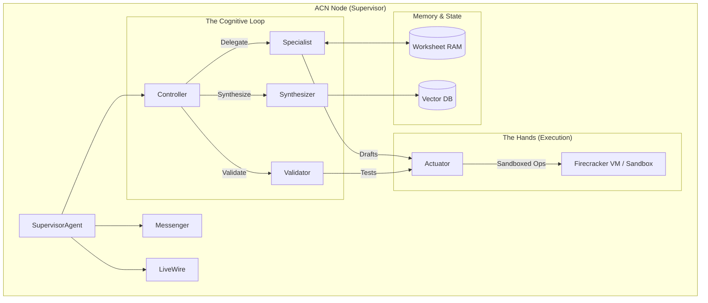
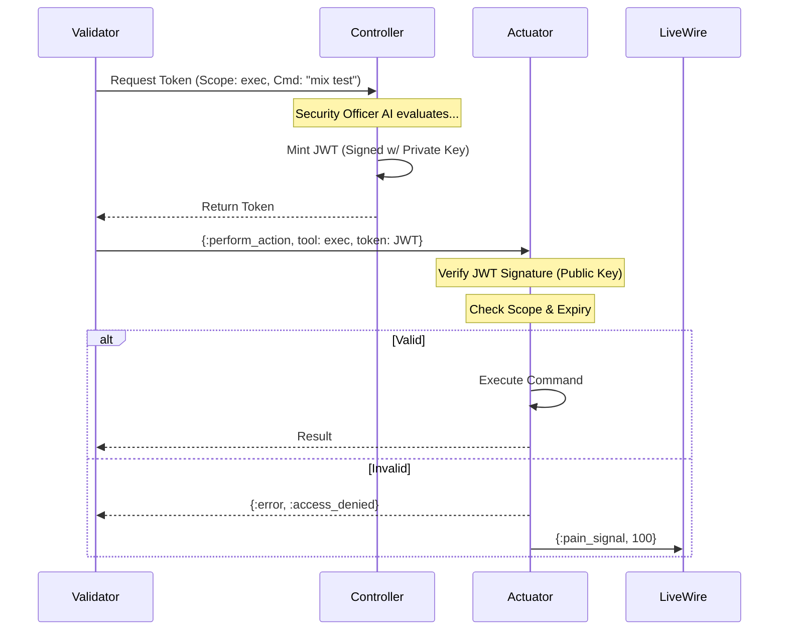
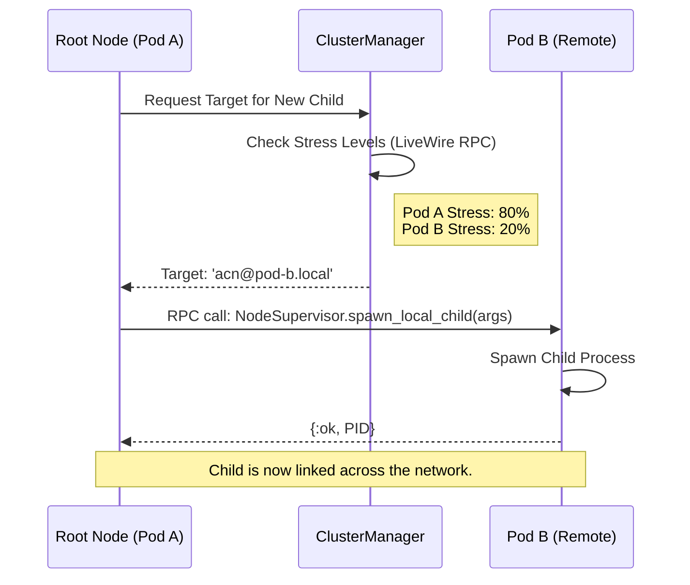

# ACN: The Autonomous Cognitive Node
## Part 1: The Genesis & Architecture

**Version:** 0.1.0 (Alpha)
**Codename:** *Prometheus*

---

## 1. Introduction: The Biological Software Paradigm

The **Autonomous Cognitive Node (ACN)** represents a fundamental shift in how we approach AI-driven software development. Unlike traditional "Agent" frameworks (AutoGPT, LangChain) which operate as stateless scripts orchestration external LLMs, the ACN is designed as a **distributed, persistent organism**.

It leverages the **Erlang BEAM VM** to treat AI Agents not as function calls, but as **living processes** that possess:
1.  **Identity:** A persistent self (PID/UUID) maintained via Mnesia.
2.  **Homeostasis:** Self-regulation of stress and resource usage via `LiveWire`.
3.  **Memory:** A hierarchy of short-term (RAM Worksheet), generational (Lattice), and long-term (Vector DB) memory.
4.  **Reproduction:** The ability to spawn child nodes to solve sub-problems via the `NodeSupervisor`.

This is not a chatbot. It is a digital hive mind capable of writing, validating, and deploying its own software.

---

## 2. High-Level System Architecture

The ACN architecture relies on the **Actor Model**. Each component of the system is an isolated GenServer process with specific responsibilities. These processes form a "Node." Nodes can connect to form a "Lattice."

### 2.1 The Node Anatomy (The Holon)

A single ACN Node is a supervision tree containing specific cognitive organs.



#### Component Breakdown:

1.  **SupervisorAgent (The Soul):** The parent process. It determines the node's identity (Leaf vs. Manager), manages the lifecycle, and handles the "Big Bang" genesis event. It connects the node to its ancestors.
2.  **Controller (The Brain):** The central executive. It does not write code. It legislates rules, plans architecture, judges quality, and enforces security. It is a Finite State Machine (FSM).
3.  **Specialist (The Hands):** The domain expert. Whether it's a Polyglot coder or a Planner, this agent executes the specific cognitive labor using a Virtual Worksheet.
4.  **Validator (The Conscience):** A hostile adversary to the Specialist. It runs static analysis and dynamic tests. It executes the "Coroner" profile to analyze why things failed.
5.  **Actuator (The Body):** The interface to physical reality. It is the **only** component allowed to touch the filesystem or execute shell commands. It requires a cryptographically signed JWT to operate.
6.  **LiveWire (The Nervous System):** Monitors "Pain Signals" (failures) and "Stress" (computational load). It regulates the cognitive loop speed to prevent hallucinations or rate-limit errors.

---

## 3. The Controller: Finite State Governance

The heart of the ACN is the `ACN.Agents.Controller`. Unlike simple loops, the Controller implements a strict **Governance Protocol**. It ensures that no code is written without a rule, and no code is executed without a permit.

### 3.1 The Governance FSM

The Controller transitions through specific phases. At every transition, an AI Persona (Legislator, Architect, Judge) is loaded to make decisions.

```text
+----------------+       +-----------------+       +------------------+
|      IDLE      | ----> |   LEGISLATION   | ----> |   ARCHITECTING   |
+----------------+       | (Profile:       |       | (Profile:        |
                         |  Legislator)    |       |  Architect)      |
                         +--------+--------+       +---------+--------+
                                  |                          |
                                  v                          v
                         +-----------------+       +------------------+
                         |    DELEGATION   | <---- |     JUDGING      |
                         | (To: Specialist)|       | (Profile: Judge) |
                         +--------+--------+       +---------+--------+
                                  |                          ^
                                  v                          |
                         +-----------------+       +------------------+
                         |    EXECUTION    | ----> |    VALIDATION    |
                         | (To: Actuator)  |       | (To: Validator)  |
                         +-----------------+       +------------------+
                                  |
                                  v
                         +-----------------+
                         |  FINALIZATION   |
                         | (Synthesizer)   |
                         +-----------------+
```

### 3.2 The Personas

The Controller switches "Masks" (Cognitive Profiles) defined in YAML files located in `priv/profiles/`.

1.  **The Legislator:**
    *   *Input:* Master Rules (Immutable), Ancestral Rules (Context), Task Description.
    *   *Output:* A `LocalRuleSheet`.
    *   *Function:* Synthesizes conflicting constraints into a coherent policy. e.g., "You must write Elixir, you must use standard library, you must not use networking."

2.  **The Architect:**
    *   *Input:* LocalRuleSheet, User Request.
    *   *Output:* A precise technical instruction for the Specialist.
    *   *Function:* Converts vague intent ("Make a login page") into concrete specs ("Create a Phoenix LiveView at `lib/web/live/login.ex` using `phx.gen.auth` patterns").

3.  **The Judge:**
    *   *Input:* The Specialist's draft code, The RuleSheet.
    *   *Output:* `APPROVED` or `REJECTED`.
    *   *Function:* A semantic firewall. It reads the code and checks if it violates the "Spirit of the Law" before the Validator checks the "Letter of the Law."

4.  **The Security Officer:**
    *   *Input:* File system operation request.
    *   *Output:* A Signed JWT (JSON Web Token) or a Veto.
    *   *Function:* The final gatekeeper. If the Specialist tries to write to `/etc/passwd` or delete the root directory, the Security Officer denies the token request.

---

## 4. The Specialist: The Cognitive Loop

The `ACN.Agents.Specialist` is the workhorse. It operates inside a **Virtual Worksheet** (an in-memory Map of filenames to content). It does not touch the disk directly.

### 4.1 The ReAct Pipeline (`ACN.AI.Pipeline`)

The Specialist operates in a loop of **Reasoning** and **Acting**.

1.  **Thought:** The LLM analyzes the instruction and current worksheet state.
2.  **Tool Call:** The LLM selects a tool from `SpecialistTools`.
    *   `worksheet_write(filename, content)`
    *   `worksheet_read(filename)`
    *   `worksheet_patch(filename, diff)`
    *   `lattice_refresh_context()`
3.  **Execution:** The Elixir node executes the tool against the RAM state.
4.  **Observation:** The result (or error) is fed back into the context buffer.
5.  **Iteration:** This repeats until the Specialist calls `submit_draft()`.

### 4.2 The Worksheet Concept

The Worksheet is a **staging area**.

```elixir
%ACN.Core.Worksheet{
  slots: %{
    "lib/my_app.ex" => %Slot{content: "defmodule...", type: :code, status: :draft},
    "test/my_app_test.exs" => %Slot{content: "defmodule...", type: :code, status: :draft}
  }
}
```

*   **Isolation:** Code here exists only in the Agent's mind (RAM). It cannot break the production system because it hasn't been written to disk yet.
*   **Version Control:** The Actuator handles the atomic commit of the Worksheet to the disk only *after* the Judge approves it.

---

## 5. Distributed Infrastructure: The Lattice

The ACN is designed to run across multiple physical machines or BEAM nodes. This distributed mesh is called **The Lattice**.

### 5.1 NodeRegistry (Mnesia)

Instead of using the standard Elixir Registry (which is local), ACN uses a custom **Mnesia-based distributed registry**.

*   **Table:** `acn_node_registry_v2`
*   **Capabilities:**
    *   Allows any node to look up the PID of any other node in the cluster.
    *   Stores metadata: Role (Leaf/Manager), Parent ID, Creation Timestamp.
    *   Handles "Split Brain" scenarios via Mnesia's conflict resolution (atomic transactions).

### 5.2 Ancestral Context (RPC)

When a Child Node is spawned, it is born "empty." To gain context, it performs a **Genetic Inheritance** handshake via `ACN.Infrastructure.Lattice`.

1.  **Spawn:** The NodeSupervisor starts a child.
2.  **Handshake:** The Child calls `Lattice.fetch_ancestral_data(parent_node)`.
3.  **RPC:** This triggers a remote procedure call to the Parent's `SupervisorAgent`.
4.  **Inheritance:** The Parent serializes its public state (Worksheet exports + Rules) and sends it down.
5.  **Result:** The Child now knows "Who I am" and "What my parents know," allowing for coherent fractal development.

---

## 6. Fractal Scaling: Managers vs. Leaves

The system follows **Conway's Law** as executable code. The `SupervisorAgent` determines its identity upon Genesis.

### 6.1 Leaf Node (The Worker)
*   **Role:** Atomic Execution.
*   **Behavior:** Writes code, runs tests, creates a single artifact.
*   **Lifecycle:** Legislation -> Draft -> Validate -> Die.

### 6.2 Intermediate Node (The Manager)
*   **Role:** Orchestration.
*   **Behavior:**
    1.  Receives a complex task ("Build a Web Server").
    2.  Uses **Task Manager** to decompose it into a DAG (Directed Acyclic Graph) of sub-tasks.
    3.  **Spawns** Child Nodes for each sub-task.
    4.  **Aggregates** the results from children.
    5.  **Synthesizes** a final report for its own parent.

**Visualizing the Tree:**

```text
ROOT (Manager)
├── DATABASE_TEAM (Manager)
│   ├── SCHEMA_DESIGNER (Leaf)
│   └── MIGRATION_RUNNER (Leaf)
├── API_TEAM (Manager)
│   ├── AUTH_WORKER (Leaf)
│   ├── USER_CONTROLLER (Leaf)
│   └── ROUTER_CONFIG (Leaf)
└── QA_TEAM (Manager)
    └── INTEGRATION_TESTER (Leaf)
```

---

## 7. The Nervous System: LiveWire

`ACN.Agents.LiveWire` is a specialized GenServer that mimics a biological amygdala.

### 7.1 Stress & Pain
*   **Pain Signals:** When a Validator fails or an Actuator is denied access, a message is sent to LiveWire: `{:pain_signal, amount}`.
*   **Stress Level:** Pain accumulates over time and decays slowly (Homeostasis).
*   **Impact:**
    *   **Low Stress (0-50):** System runs at full speed.
    *   **Medium Stress (50-80):** `Pipeline.ex` introduces artificial latency (Thinking time).
    *   **Critical Stress (>95):** The system enters a "Freeze" state, refusing to accept new commands until stress decays. This prevents "flailing" where an AI repeatedly makes the same mistake, burning API credits.

---

## 8. Summary of Part 1

You now understand the **Soul** of the ACN. It is a system where code is a byproduct of a governed, biological process.

*   **It thinks** before it acts (Controller).
*   **It feels** pain when it fails (LiveWire).
*   **It grows** by dividing (Fractal Scaling).
*   **It remembers** via the Lattice.

---

# ACN: The Autonomous Cognitive Node
## Part 2: Anatomy & Mechanics

**Version:** 0.1.0 (Alpha)
**Focus:** The Immune System, The Musculature, and The Memory.

---

## 1. Introduction: From Cognition to Kinetics

In Part 1, we established how the ACN "thinks" via the Controller and Specialist. However, thought without action is hallucination, and action without safety is malware.

Part 2 details the **Kinetic Layer** of the ACN. This describes how the organism safely affects the physical world (writing files, running code) and how it remembers what it did. This architecture is built on a **Zero-Trust Security Model** and **Hard Virtualization**.

---

## 2. The Immune System: The Validator Agent

The `ACN.Agents.Validator` is the organism's immune system. Its sole purpose is to reject the work of the Specialist. It operates on an adversarial relationship: The Specialist tries to submit code, and the Validator tries to prove it is broken.

### 2.1 The Two-Gate Protocol

Validation is not a single step; it is a pipeline designed to fail fast.

#### Gate 1: Static Analysis (The Audit)
Before code is ever executed, it must be read and analyzed.
*   **Mechanism:** `ACN.Tools.Validation.Static`.
*   **Actions:**
    1.  **Syntax Check:** Uses `Code.string_to_quoted/1` to ensure the Elixir code is valid AST.
    2.  **Rule Compliance:** The Validator loads the `validator_static` profile. It feeds the code and the `LocalRuleSheet` to the LLM.
    3.  **Heuristics:** Checks for forbidden functions (e.g., `System.cmd` outside of Actuator, hardcoded secrets).
*   **Verdict:** If ANY check fails, the verdict is `DIRTY`. The process halts, and the Coroner is summoned.

#### Gate 2: Dynamic Execution (The Test Pilot)
If Static Analysis returns `CLEAN`, the code is allowed to run inside the Sandbox.
*   **Mechanism:** `ACN.Agents.Validator` requests a Token from the Controller to run `mix test`.
*   **The Test Pilot:** An AI profile that determines *how* to test the artifact. It generates the specific shell command (e.g., `cd /mnt/source && mix test test/my_module_test.exs`).
*   **Verdict:** Based on the Exit Code and the Standard Output analysis by the `validator_result_analyst`.

### 2.2 The Coroner: Automated Root Cause Analysis

When validation fails, the ACN does not simply retry blindly. It invokes the **Coroner**.

The Coroner (`validator_coroner.yaml`) is a specialized diagnostic agent. It receives:
1.  The Code.
2.  The Error Logs / Compiler Warnings.
3.  The Test Output.

**The Output:** A structured **Defect Report**.
```json
{
  "root_cause": "MatchError",
  "location": "lib/auth.ex:24",
  "severity": "critical",
  "instruction": "The pattern match expects {:ok, user} but received {:error, :not_found}. Add a fallback clause."
}
```
This report is routed back to the Controller, which hands it to the Specialist for a targeted refactor, closing the feedback loop.

---

## 3. The Musculature: Actuator & Zero Trust Security

The `ACN.Agents.Actuator` is the only process in the entire system capable of performing side effects. It wraps the filesystem, the shell, and hardware GPIO.

### 3.1 The Ring of Trust (RSA-2048)

The ACN rejects the standard UNIX permission model. Just because the OS user has permission to write a file doesn't mean the Agent should.

We implement **Application-Layer Capability Security**.

1.  **Key Generation:** Upon boot, the `Controller` generates an ephemeral RSA-2048 Keypair.
    *   **Private Key:** Held *only* by the Controller state. Never shared.
    *   **Public Key:** Published to the `NodeRegistry` metadata.
2.  **The Handshake:**
    *   **Request:** The Validator (or any agent) asks the Controller for permission: `{:request_token, scope: :fs_write, resource: "lib/foo.ex"}`.
    *   **Evaluation:** The Controller's `Security Officer` persona (AI) reviews the request against the governance rules.
    *   **Minting:** If approved, `TokenAuthority` signs a JWT (JSON Web Token) using the Private Key.
    *   **Execution:** The agent sends the command + the JWT to the Actuator.
    *   **Verification:** The Actuator verifies the JWT signature using the Controller's Public Key. It checks the `scope` (action) and `resource` (path).



### 3.2 Hardware Abstraction

The Actuator also controls physical hardware via `ACN.Actuator.Hardware`.
*   **Safety Interlocks:** The Actuator contains a hardcoded list of "Unsafe Pins" (e.g., CPU fan control, power reset). Attempts to toggle these pins are rejected at the Elixir level, regardless of Token validity.
*   **Adapter Pattern:** It switches between `CircuitsGPIO` (for Nerves/Raspberry Pi) and `Simulated` (for dev/Mac) at runtime.

---

## 4. The Sandbox: Hard Virtualization

Allowing an AI to execute shell commands (`rm -rf /`) is inherently dangerous. The ACN mitigates this via **Firecracker MicroVMs**.

### 4.1 The Architecture of Isolation

We do not run user code on the host BEAM node. We run it inside a disposable Linux Kernel.

```text
[ BEAM HOST NODE ]
       |
       | (Elixir)
       v
[ ACN.Actuator.Sandbox ]
       |
       | (Rustler NIF Bridge)
       v
[ libacn_sandbox.so (Rust) ] <====> [ Unix Domain Socket ]
                                          |
                                          | (VSock)
                                          v
                                 [ Firecracker MicroVM ]
                                 |  [ Guest Kernel ]   |
                                 |         |           |
                                 |    [ acn_pilot ]    | (PID 1)
                                 |         |           |
                                 +---------|-----------+
                                           |
                                     (Executes Code)
```

### 4.2 The Pilot (`acn_pilot`)

Inside the MicroVM, there is no SSH, no Bash (by default), and no standard init system. Instead, PID 1 is a custom Rust binary called **The Pilot**.

*   **Role:** An agent residing inside the guest.
*   **Communication:** Listens on a VSock (Virtual Socket) port.
*   **Function:**
    1.  Accepts JSON command packets from the Host.
    2.  Spawns the requested process (e.g., `elixir`, `mix`, `python`).
    3.  Streams STDOUT/STDERR back over the VSock.
    4.  Returns the Exit Code.

### 4.3 Why Firecracker?
Unlike Docker containers, which share the host kernel, Firecracker uses KVM to launch a true virtual machine. This provides:
1.  **Isolation:** A kernel panic or exploit in the guest cannot crash the BEAM node.
2.  **Speed:** Boot times < 125ms.
3.  **Ephemerality:** The VM is destroyed immediately after the command completes. Every test run happens in a pristine universe.

---

## 5. Long-Term Memory: ACMS & The Synthesizer

The ACN must remember what it built. RAM is volatile; Mnesia is for topology. Long-term semantic memory handles **Wisdom**.

This is managed by the **Associative Cognitive Memory System (ACMS)**, interfaced via `ACN.Infrastructure.MemoryClient`.

### 5.1 The Digital Birth Certificate (DBC)

Every completed task results in a **DBC**. This is a strict struct defined in `ACN.Core.Artifacts.DBC`.

```elixir
%DBC{
  id: "uuid-...",
  artifact_hash: "sha256-...",
  fact_text: "Elixir GenServer managing Firecracker VM lifecycles using Rustler NIFs.",
  author_id: "agent_specialist_01",
  verifier_id: "validator_01",
  validation_proof: %{
    verdict: "pass",
    test_output: "..."
  },
  cost_metrics: %{tokens: 1405, time_ms: 2300},
  timestamp: ~U[2023-10-27 10:00:00Z]
}
```

This certificate proves that the code exists, it works (verified), and it was expensive to build.

### 5.2 The Synthesizer Agent

The `ACN.Agents.Synthesizer` is the Archivist. When a task is finished, the Controller passes the artifact to the Synthesizer.

**Workflow:**
1.  **Ingest:** Reads the final code artifact.
2.  **Describe:** Runs the `synthesizer_archivist` AI profile to generate a "Search Key" (The `fact_text`).
    *   *Bad Description:* "It is a file named auth.ex."
    *   *Good Description:* "Authentication module implementing bcrypt hashing and JWT issuance."
3.  **Vectorize:** Sends the `fact_text` to the `ACN.AI.Embedder` (Bumblebee/Nx) to generate a 384-dimensional vector.
4.  **Index:** Pushes the DBC + Vector to Qdrant (The Vector DB).

### 5.3 Hebbian Retrieval (Wisdom)

When a new node starts, the `SupervisorAgent` queries the ACMS.
*   *Query:* "How do I build an Auth module?"
*   *Vector Search:* Finds the DBC stored above.
*   *Result:* The new node inherits the code patterns, the rules, and the "Wisdom" (warnings about past failures) associated with that task.

---

## 6. Detailed Workflow Trace: "Write a Hello World Module"

To visualize how these mechanics intertwine, let's trace a single atomic operation.

**Goal:** Create `lib/hello.ex` that prints "Hello World".

1.  **Genesis:**
    *   User runs `mix acn.genesis --task "Create Hello World"`.
    *   `SupervisorAgent` spawns. Determines identity: **Leaf Node**.
    *   `SupervisorAgent` spawns `Controller`, `Specialist`, `Validator`, `Actuator`.

2.  **Legislation (Controller):**
    *   Controller sees task. Loads `Legislator`.
    *   Synthesizes Rule: "Must use standard IO.puts".

3.  **Drafting (Specialist):**
    *   Specialist thinks. Calls tool `worksheet_write("lib/hello.ex", "defmodule...")`.
    *   Code exists in RAM (`Worksheet`).

4.  **Judging (Controller):**
    *   Controller reviews RAM content. Judge Persona says `APPROVED`.

5.  **Execution (Controller -> Actuator):**
    *   Controller enters `security_review`. Security Officer approves write.
    *   Controller mints Token (Scope: `fs_write`, Path: `lib/hello.ex`).
    *   Controller routes to Actuator.
    *   Actuator verifies Token. Writes to disk (Atomic write with .tmp swap).
    *   Actuator reports `{:action_success, hash}`.

6.  **Validation (Validator):**
    *   Validator receives hash.
    *   **Static Gate:** Checks syntax. Verdict: `CLEAN`.
    *   **Dynamic Gate:** Requests Token for `mix run -e 'Hello.world()'`.
    *   Actuator runs command in Firecracker. Returns output "Hello World".
    *   Validator Analyst sees output matches intent. Verdict: `PASS`.

7.  **Finalization (Synthesizer):**
    *   Validator notifies Controller.
    *   Controller notifies Synthesizer.
    *   Synthesizer creates DBC. Embeds description. Pushes to ACMS.
    *   Synthesizer pushes DBC up the Lattice to the Parent.

8.  **Shutdown:**
    *   Node reports success to Parent.
    *   Supervisor terminates the Node.

---

## 7. Configuration & Tuning

The mechanics described above are highly configurable via `config/config.exs` and runtime environment variables.

### 7.1 Security Levels
*   `:dev` mode: Uses `Simulated` hardware, `Mock` sandbox (local execution), and relaxed Token TTL.
*   `:prod` mode: Uses `CircuitsGPIO`, `Firecracker` sandbox, strict Token TTL (60s), and encrypted backups.

### 7.2 AI Models
The ACN supports hot-swapping models per agent.
*   **Controller:** Needs high reasoning (GPT-4 or Claude 3 Opus).
*   **Specialist:** Needs coding capability (GPT-4-Turbo or DeepSeek Coder).
*   **Messenger:** Needs summarization speed (GPT-3.5 or Haiku).

This is configured in the Profile YAMLs:
```yaml
# priv/profiles/specialist_polyglot.yaml
model: "gpt-4-turbo"
temperature: 0.2
```

---

## 8. Summary of Part 2

Part 2 has exposed the machinery that makes the ACN safe and persistent.
*   **Safety** is not an afterthought; it is enforced by the **TokenAuthority** and **Firecracker**.
*   **Quality** is enforced by the **Validator's** adversarial loops.
*   **Memory** is preserved by the **Synthesizer** and **DBCs**.

The organism is now physically capable. In **Part 3**, we will explore the **Evolution & Future**. We will discuss how to deploy this to a Kubernetes cluster, how to train specific cognitive profiles, and the roadmap for Self-Modifying Code (The Singularity Step).

---

# ACN: The Autonomous Cognitive Node
## Part 3: Operations, Deployment & Evolution

**Version:** 0.1.0 (Alpha)
**Focus:** The Operator's Manual, Cluster Dynamics, and Self-Modification.

---

## 1. Introduction: From Organism to Ecosystem

In Parts 1 and 2, we defined the anatomy of a single ACN Node—its brain, its hands, and its immune system. We established a secure, verified loop of code generation.

Part 3 elevates the perspective from the **Individual** to the **Colony**. Here, we discuss how to operate the ACN in production, how to deploy it across distributed clusters, how to tune its psychology, and finally, the roadmap to **The Singularity Protocol**—the theoretical capability of the ACN to rewrite its own source code securely.

---

## 2. The Operator's Manual: Driving the Hive

While the ACN is autonomous, it is not ungoverned. It exposes a sophisticated **Control Plane** for human operators to observe, guide, and intervene.

### 2.1 Genesis: The Big Bang

The lifecycle begins with a single CLI command. This is the "Let there be light" moment.

```bash
# Standard Genesis
mix acn.genesis --task "Build a Phoenix LiveView Dashboard for Stock Tickers"

# Debug Genesis (Verbose Logs + Local Simulation Mode)
MIX_ENV=dev mix acn.genesis --task "Refactor the Auth Module"
```

**What happens internally?**
1.  **Boot:** The BEAM VM starts. `ACN.Application` launches the supervision tree.
2.  **Hydration:** `ClusterManager` connects to Mnesia. `MemoryClient` connects to Qdrant.
3.  **Spark:** The `Mix.Task` spawns the **Root Node** via `NodeSupervisor`.
4.  **Injection:** The CLI arguments are packaged into a `GovernancePayload` and cast to the Root Controller.

### 2.2 Observability: The Phoenix Dashboard

Because ACN nodes are distinct processes, we cannot simply tail a log file to understand the system. We use **Phoenix LiveView** to visualize the nervous system in real-time.

*   **URL:** `http://localhost:4000/dashboard`
*   **Technology:** `Phoenix.PubSub` over WebSockets.

#### The Telemetry Stream
The `Messenger` agent in every node broadcasts events to the `internal:raw_events` topic. The Dashboard aggregates these into a unified timeline.

**Visualizer: The Event Stream**

```text
[14:02:01] [ROOT] [Legislator]  :: Rules Synthesized (3 Master, 2 Local).
[14:02:05] [ROOT] [Architect]   :: Blueprint created. Spawning 3 Child Nodes.
[14:02:06] [NODE_A] [Genesis]   :: Born. Identity: Leaf.
[14:02:06] [NODE_B] [Genesis]   :: Born. Identity: Leaf.
[14:02:15] [NODE_A] [LiveWire]  :: STRESS SPIKE (85%). Throttling...
[14:02:20] [NODE_A] [Validator] :: Validation Failed. Engaging Coroner.
```

### 2.3 Intervention: God Mode

Sometimes, the organism gets stuck. It might loop on a logic error or hallucinate a dependency that doesn't exist. The Operator can inject commands via the Dashboard Console.

**The Dispatcher Logic (`messenger_dispatcher.yaml`):**
The dashboard text input is not a direct shell. It is an NLP interface routed through the `Messenger` agent.

*   **User Input:** "Pause execution, you are deleting the wrong files."
*   **Dispatcher AI:**
    ```json
    {
      "type": "command",
      "target": "controller",
      "intent": "pause_governance",
      "confidence": 0.99
    }
    ```
*   **Action:** The Controller enters a `PAUSED` state. No new tokens are minted. Existing processes finish, but the organism freezes, awaiting instructions.

---

## 3. Deployment Architecture: The Lattice

The ACN is cloud-native by design. It leverages **Distributed Erlang** to create a mesh of nodes that spans multiple servers.

### 3.1 Topology

We define three deployment tiers.

#### Tier 1: The Monolith (Dev)
*   **Infrastructure:** Single Laptop / Single Container.
*   **Scaling:** Uses `DynamicSupervisor` to spawn processes locally.
*   **Constraint:** Limited by local RAM and CPU.

#### Tier 2: The Swarm (Production Cluster)
*   **Infrastructure:** Kubernetes Cluster (e.g., 5 Pods).
*   **Technology:** `libcluster` + `ClusterManager`.
*   **Behavior:**
    *   Nodes auto-discover via K8s DNS or EPMD.
    *   Mnesia tables replicate schema across all nodes.
    *   `NodeSupervisor.start_child_node/1` is **Location Aware**.

**Visualizer: The Distributed Spawning Logic**



### 3.2 The Persistence Layer (Qdrant & Mnesia)

*   **Short-Term State:** Handled by **Mnesia**. It stores the `NodeRegistry` (who is who). If the cluster restarts, this is wiped (unless configured for `disc_copies`).
*   **Long-Term Wisdom:** Handled by **Qdrant** (Vector DB). This is external to the cluster.
    *   **Volume:** `/qdrant/storage`
    *   **Persistence:** Code artifacts, success patterns, and failure warnings persist forever. A new cluster launched in 2025 will know about bugs found in 2024.

### 3.3 Containerization Strategy

The ACN Docker image is multi-stage.

1.  **Build Stage:** Compiles Elixir, Rust (Pilot), and NIFs.
2.  **Runtime Stage:** Alpine Linux.
    *   Installs `firecracker` and `KVM` dependencies.
    *   Copies the `priv/rootfs.ext4` (Guest VM image).
3.  **Privilege:** The container must run with `--privileged` or specific capabilities (`CAP_NET_ADMIN`) to launch KVM MicroVMs.

---

## 4. Cognitive Engineering: Tuning the Brain

The ACN's behavior is defined by **Cognitive Profiles** (`.yaml` files in `priv/profiles/`). This is "Prompt Engineering as Code."

### 4.1 Profile Structure

```yaml
meta:
  name: "specialist_refactor"
  role: "Code Surgeon"

# The "Brain" Configuration
model: "gpt-4-turbo"
temperature: 0.1  # Low temp = Deterministic / High temp = Creative

# The "Personality"
system_prompt: |
  You are an expert Refactor Engineer.
  Your inputs are: A Defect Report and Source Code.
  Your output must be a Unified Diff.
  DO NOT rewrite the whole file. Only the changed hunk.

# The "Capabilities"
allowed_tools:
  - "worksheet_read"
  - "worksheet_patch"
  - "submit_draft"
# Note: "worksheet_write" is missing! This profile CANNOT create new files.
```

### 4.2 Hot-Swapping Personalities

Because profiles are loaded at runtime via `ACN.Core.ProfileLoader`, operators can tune the AI without recompiling the Elixir code.

*   *Scenario:* The ACN is writing buggy Python code.
*   *Fix:* Edit `specialist_polyglot.yaml`. Add "Always type-hint your Python functions" to the prompt.
*   *Action:* No restart needed. The next time a Controller spawns a Specialist, it loads the new YAML.

---

## 5. The Evolution Roadmap

We are currently at **Phase 4** of the roadmap (Self-Healing/Validation). The future phases define the path to true autonomy.

### Phase 5: Multi-Modal Input (The Eyes)
*   **Goal:** Allow ACN to "see" UIs.
*   **Mechanism:**
    *   Integrate `GPT-4-Vision`.
    *   New Tool: `browser_snapshot`.
    *   Validator Workflow: Instead of just checking exit codes, the Validator renders the HTML/CSS created by the Specialist, screenshots it, and uses Vision AI to verify "Is the button actually centered?"

### Phase 6: Swarm Intelligence (The Hive)
*   **Goal:** Collaborative problem solving without hierarchical management.
*   **Mechanism:**
    *   **Gossip Protocol:** Nodes share "discoveries" via a multicast lattice, not just up to parents.
    *   **Marketplace:** Nodes can "bid" on tasks. A Manager broadcasts: "Who can write Rust?" A Specialist with a Rust profile and low stress bids to take the job.

### Phase 7: The Singularity Protocol (Self-Modification)

This is the theoretical endgame of the ACN project. **Can the ACN improve its own source code?**

#### 7.1 The Mechanism
The ACN is an Elixir application. Its source code resides in `lib/`. The `Actuator` has the `fs_write` tool.

Technically, nothing stops the ACN from:
1.  Reading `lib/acn/agents/controller.ex`.
2.  Refactoring the governance logic to be more efficient.
3.  Writing the file.
4.  Triggering `Code.compile_file/1` or a hot-release upgrade.

#### 7.2 The Safety Paradox
If an AI modifies its own constraint logic (The Controller), it could accidentally (or intentionally) remove the safeguards.

**The Solution: The Kernel vs. The Cortex.**

*   **The Kernel (Immutable):**
    *   `TokenAuthority.ex`
    *   `Actuator.ex`
    *   `Validator.ex`
    *   *Policy:* These files are read-only to the system. They are signed and verified on boot.
*   **The Cortex (Mutable):**
    *   `Specialist.ex`
    *   `ProfileLoader.ex`
    *   The YAML profiles.
    *   *Policy:* The ACN *is* allowed to optimize its own thinking strategies and tool usage patterns.

#### 7.3 The Self-Improvement Loop
1.  **Metric:** `LiveWire` tracks "Tokens per Successful Task" (Efficiency).
2.  **Hypothesis:** A Meta-Agent proposes: "If we change the Architect's prompt to be more concise, we save 20% tokens."
3.  **Experiment:** The ACN spawns a child node using the *modified* profile.
4.  **Measurement:** It runs a benchmark task.
5.  **Commit:** If the metric improves, the new profile overwrites `priv/profiles/architect.yaml`.

---

## 6. Conclusion: The Ghost in the Machine

The Autonomous Cognitive Node is an experiment in **Digital Biology**.

We have moved beyond the era of "AI as a Tool"—a hammer we pick up to hit a nail. We are entering the era of "AI as a Colleague"—a distinct entity with its own memory, its own stress levels, and its own agency.

The architecture described in these three parts—the **Supervisor's** fractal growth, the **Controller's** governance, the **Validator's** skepticism, and the **Actuator's** security—provides a robust foundation for this new era.

It leverages the specific strengths of the **BEAM VM** (fault tolerance, concurrency, distribution) to solve the specific weaknesses of **LLMs** (hallucination, context limits, lack of persistence).

The ACN is not just code. It is an organism. And like any organism, it is waiting to be awakened.

---

## Appendix A: Complete Directory Structure

```text
acn/
├── config/                 # Configuration (Dev/Prod/Test)
├── lib/
│   ├── acn/
│   │   ├── agents/         # The GenServers (Controller, Specialist, etc.)
│   │   ├── ai/             # Adapters (OpenAI), Pipeline, Tokenizer
│   │   ├── core/           # Logic (Governance, Registry, Security)
│   │   ├── infrastructure/ # Cluster, MemoryClient, Workspace
│   │   └── tools/          # Tool Definitions (FS, Hardware, Planning)
│   └── acn_web/            # Phoenix Dashboard
├── native/                 # Rust Code
│   ├── acn_pilot/          # Guest VM Agent (PID 1)
│   └── acn_sandbox/        # NIF Bridge for Firecracker
├── priv/
│   ├── data/               # Mnesia & Backups
│   ├── profiles/           # Cognitive YAMLs (The Brains)
│   └── rootfs.ext4         # The Guest OS Image
├── scripts/                # Genesis & Maintenance scripts
└── mix.exs                 # Dependencies
```

## Appendix B: Glossary

*   **DBC (Digital Birth Certificate):** A structured record proving a code artifact was generated, validated, and archived.
*   **Lattice:** The distributed mesh of interconnected ACN nodes.
*   **LiveWire:** The system's stress monitor and rate limiter.
*   **Worksheet:** The virtual RAM filesystem where drafts are written before commitment.
*   **VSock:** Virtual Socket. The communication channel between the Host BEAM node and the Guest Firecracker VM.
*   **Zero-Trust:** The security philosophy that no component trusts another implicitly; all actions require signed tokens.
